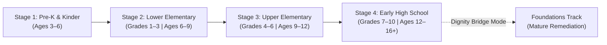

# Pupil PH: Research, Pedagogical Framework & Style Guide
**Document Identifier:** `PUPIL-DOC-01`  
**Target Platform:** Web Application (Tablets, Laptops, Desktops)  
**Target Region:** Republic of the Philippines (DepEd K–12 & MATATAG Curriculum Alignment)  
**Version:** 1.0.0  
**Status:** Approved Specification  

---

## 1. Executive Summary & Mission Statement

### 1.1 Vision
**Pupil PH** is a lightweight, responsive, and culturally grounded web application designed to empower Filipino learners across four foundational stages:
1. **Pre-School & Kindergarten (Ages 3–6)**
2. **Lower Elementary (Grades 1–3 | Ages 6–9)**
3. **Upper Elementary (Grades 4–6 | Ages 9–12)**
4. **Early High School (Grades 7–10 | Ages 12–16+) & Older Beginners**

The platform integrates three core pillars:
* **Tech Literacy:** Understanding hardware, operating systems, file management, the internet, digital citizenship, and cybersecurity.
* **Basic Functional English:** Reading, vocabulary acquisition, and sentence structure delivered in controlled, high-frequency, simple English without dialect barriers.
* **Typing & Input Mastery:** Developing ergonomic touch-typing, keyboard navigation, shortcut proficiency, and accurate touch-screen input.

### 1.2 Core Pedagogical Axioms
1. **Zero-Infantilization Principle:** Older students with foundational deficits must be met with dignity, respect, and mature aesthetics. Under no circumstance should a 14-year-old high school learner encounter cartoon animals, childish nursery songs, or babyish labels when learning elementary concepts.
2. **Pure Simple English Policy:** All user interfaces, instructional texts, and practice drills are written in strictly controlled, unadorned Simple English. No Tagalog or Taglish is used in UI strings or lessons. This accelerates genuine immersion and English proficiency while preventing regional linguistic exclusion (e.g., Cebuano, Ilocano, Hiligaynon, or Waray speakers feeling alienated by Tagalog-centric translations).
3. **Hyper-Local Contextual Anchors:** English language learning is grounded in concrete, everyday Philippine experiences (e.g., *sari-sari* stores, jeepney routes, fresh mangoes, school computer laboratories, monsoon rain, brownouts, and common mobile phone scams). Learners do not struggle with unfamiliar Western cultural metaphors (such as "baseball innings," "lemonade stands," or "fall leaves").
4. **Resource-Constrained Resilience:** Software architecture assumes the reality of Philippine public schools: low-specification budget hardware, intermittent or non-existent connectivity, shared devices, and sudden electrical power cuts ("brownouts"). The application is offline-first, ultra-lightweight, and saves state every few seconds.

---

## 2. Target Audience Profiles Across the 4 Stages



---

### 2.1 Stage 1: Pre-School & Kindergarten (Ages 3–6)

#### A. Developmental Profile
* **Physical & Motor Skills:** Rapidly developing gross and fine motor coordination. Struggles with fine mouse precision or finger independence. Tablet touchscreens with single-finger tap and coarse dragging are primary.
* **Cognitive & Linguistic State:** Emergent readers and pre-readers. Phonemic awareness is developing. Highly reliant on auditory feedback, visual cues, and iconography. English is generally a secondary language encountered through television, YouTube, or school songs.
* **Attention Span:** 3 to 7 minutes per focused activity. Requires continuous micro-rewards, lively animations, and clear auditory prompts.

#### B. Tech Literacy & Input Baseline
* **Current Exposure:** Passive consumers on hand-me-down mobile phones or shared family Android tablets (e.g., watching videos). Little to no understanding of digital hardware components, files, or keyboard layout.
* **Stage Goals:**
  * Identify external computer parts: Screen/Monitor, Mouse, Keyboard, Power Button, Headphones.
  * Master basic input actions: Tap, Double Tap, Drag-and-Drop, Spacebar press, and single Letter tapping.
  * Letter-to-Key Association: Recognize uppercase and lowercase letters on a visual keyboard matching phonics sounds.

#### C. Typical Persona
> **Name:** Aya, Age 5  
> **Grade:** Kindergarten (DepEd Public Central School)  
> **Environment:** Sits at a shared low-table with 4 classmates; the classroom has two 8-inch Android tablets donated by the local government unit (LGU).  
> **Linguistic Background:** Speaks Cebuano at home; learns basic English greetings and alphabet in class.  
> **Pain Point:** Frustrated when text on screen is unvoiced. Accustomed to touching screens, but struggles when UI buttons are smaller than 48px.

---

### 2.2 Stage 2: Lower Elementary (Grades 1–3 | Ages 6–9)

#### A. Developmental Profile
* **Physical & Motor Skills:** Fine motor skills stabilized. Capable of two-hand coordination, left/right hand separation, and using a standard optical desktop mouse (click, double click, scroll wheel).
* **Cognitive & Linguistic State:** Transitioning from decoding phonics to reading fluency. Aligned with DepEd MATATAG Key Stage 1 Reading and Literacy competencies. Capable of understanding 3-to-6-word simple declarative sentences.
* **Attention Span:** 10 to 15 minutes of sustained focus before cognitive fatigue.

#### B. Tech Literacy & Input Baseline
* **Current Exposure:** Occasional access to school computer laboratories (once per week, often 2 or 3 students per desktop PC). Mobile phone usage at home for messaging and games.
* **Stage Goals:**
  * Understand the desktop interface: Desktop, Icons, Window, Close Button `[X]`, Taskbar.
  * Master two-hand home row keyboard placement: Left Hand (`A-S-D-F`), Right Hand (`J-K-L-;`), and Thumbs on the Spacebar.
  * Basic Typing Competency: 5 to 12 Words Per Minute (WPM) with 85%+ accuracy on single words and 2-to-4 word phrases.
  * Digital Citizenship & Safety: Never share personal passwords; ask a parent or teacher before clicking unknown links.

#### C. Typical Persona
> **Name:** Joshua, Age 8  
> **Grade:** Grade 2 (Barangay Elementary School)  
> **Environment:** Visits the school's DepEd Computerization Program (DCP) lab for 40 minutes on Thursdays; shares a desktop with his seatmate.  
> **Linguistic Background:** Speaks Tagalog and conversational English; reads phonetically but stumbles over irregular English spellings.  
> **Pain Point:** Frequently loses track of the mouse cursor on screen; types with two index fingers ("hunt-and-peck") and looks down at the keyboard constantly.

---

### 2.3 Stage 3: Upper Elementary (Grades 4–6 | Ages 9–12)

#### A. Developmental Profile
* **Physical & Motor Skills:** Full finger dexterity. Ready for structured muscle memory training (touch typing without looking at keys).
* **Cognitive & Linguistic State:** Functional English readers. Aligned with DepEd MATATAG *Edukasyong Pantahanan at Pangkabuhayan* (EPP) ICT competencies. Able to follow multi-step written instructions, understand cause-and-effect in software, and evaluate basic information credibility.
* **Attention Span:** 20 to 30 minutes of structured goal-oriented tasks. Motivated by skill badges, levels, and quantifiable speed improvements.

#### B. Tech Literacy & Input Baseline
* **Current Exposure:** Regular school lab sessions; uses web browsers for homework research; active on social messaging apps (Messenger, TikTok) via mobile devices.
* **Stage Goals:**
  * File System Fluency: Create, rename, move, and delete folders; understand file types (`.docx`, `.jpg`, `.pdf`); understand storage drives and downloads.
  * Internet Navigation & Search: Use a browser address bar vs. search engine; evaluate search results; identify secure websites (`https://` lock icon).
  * Touch Typing Mastery: 15 to 25 WPM with 90%+ accuracy on full sentences using punctuation (period, comma, question mark, capitalization with Shift key).
  * Cyber Hygiene & Scam Awareness: Recognize common deceptive tactics (fake prize popups, "Free Robux/Free Diamonds" links, phishing messages asking for parent's phone numbers or OTPs).

#### C. Typical Persona
> **Name:** Bea, Age 11  
> **Grade:** Grade 5 (Urban Public Elementary School)  
> **Environment:** Lab with 45 students sharing 20 Celeron desktop PCs; uses Piso-WiFi outside her home on weekends to do schoolwork.  
> **Linguistic Background:** Bilingual in Tagalog/English; reads standard elementary textbooks.  
> **Pain Point:** Inadvertently clicks misleading advertisements ("Download Here" traps) when searching for project images; experiences wrist fatigue from improper typing posture.

---

### 2.4 Stage 4: Early High School (Grades 7–10 | Ages 12–16+) & Older Beginners

#### A. Developmental Profile
* **Physical & Motor Skills:** Mature adult physiology. Rapid reflex response, capable of high typing speed and complex shortcut execution (`Ctrl+C`, `Ctrl+V`, `Ctrl+Z`, `Alt+Tab`).
* **Cognitive & Linguistic State:** Advanced abstract thinking, social consciousness, career exploration. Aligned with DepEd MATATAG *Technology and Livelihood Education* (TLE) ICT sectors (Computer Systems Servicing, Programming, Visual Arts, and Office Applications).
* **Social & Emotional Dynamics:** Acute sensitivity to peer perception. High risk of feeling ashamed ("*napahiya*") if perceived as technologically illiterate or deficient in English.

#### B. Tech Literacy & Input Baseline (The Dual Cohort Reality)
In the Philippine secondary education system, Grade 7–10 classrooms exhibit extreme polarization:
1. **The Digital Natives:** Mobile-first teens who produce video content, communicate rapidly via smartphones, but have never typed a formal paper on a physical QWERTY keyboard.
2. **The Digitally Excluded / Late Starters:** Students who transferred from remote rural (*poblacion* or upland) schools without electricity or labs. They lack basic mouse coordination, struggle with English syntax, and feel deep intimidation when seated at a computer terminal.

#### C. Stage Goals
* **Professional Input Efficiency:** 30 to 45+ WPM with 95%+ accuracy on formal prose, technical terminology, and code syntax.
* **Keyboard Navigation Mastery:** High productivity without mouse reliance (Tab navigation, clipboard shortcuts, window switching, text selection with `Shift + Arrow`).
* **Systems & Digital Workplace Fluency:** Understanding cloud storage, email communication, document formatting, spreadsheet data entry, and digital privacy settings.
* **Critical Cybersecurity:** Identifying advanced phishing, social engineering scams, suspicious email headers, fake government portals, and fraudulent mobile load/lending app schemes.

#### D. The Critical Remediation Persona
> **Name:** Mark, Age 14  
> **Grade:** Grade 8 (Provincial National High School)  
> **Environment:** National High School computer lab with 50 desktop stations running Windows 10; class size is 48 students.  
> **Background:** Family does not own a computer or tablet; his primary tech exposure was an old keypad phone until Grade 7. Struggles to find keys on a keyboard and reads English at a Grade 3 level.  
> **Psychological Barrier:** Terrified that his classmates will laugh at him if they see him doing elementary-level typing drills. If the platform shows cartoon badges, balloons, or "Grade 2" labels, he will immediately close the tab and refuse to participate.

---

## 3. Philippine Educational & Technological Infrastructure Realities

```
+-----------------------------------------------------------------------------------+
|                           PHILIPPINE CLASSROOM REALITIES                           |
+-----------------------------------------------------------------------------------+
|  HARDWARE REALITY          |  CONNECTIVITY REALITY       |  ENVIRONMENTAL REALITY  |
|  - DepEd DCP Celeron/Atom  |  - Intermittent / 0-bar DSL |  - 34°C ambient room    |
|  - 2GB–4GB RAM systems     |  - High-latency Piso-WiFi   |  - Rain on tin roofs    |
|  - 2–3 students per PC     |  - Data-capped 4G hotspots  |  - Sudden brownouts     |
|  - Missing keycaps on keys |  - Offline PWA mandatory    |  - Screen glare / sun   |
+-----------------------------------------------------------------------------------+
```

### 3.1 DepEd MATATAG Curriculum Alignment
The platform directly addresses the foundational mandates of the revised Philippine basic education curriculum:

| Educational Stage | DepEd MATATAG Learning Area | Integrated Pupil PH Competency Focus |
|---|---|---|
| **Pre-K & Kinder** | Kindergarten Curriculum (Blocks of Time, Early Literacy) | Alphabet recognition, directional audio following, single-touch UI motor control, computer hardware identification. |
| **Grades 1–3** | Reading and Literacy (Key Stage 1), Language, English (Grades 2–3) | Phonics decoding, high-frequency sight words, home-row finger placement, single-word and short sentence typing. |
| **Grades 4–6** | Edukasyong Pantahanan at Pangkabuhayan (EPP) - ICT Component | File and folder management, basic word processing mechanics, safe internet research, password hygiene, scam identification. |
| **Grades 7–10** | Technology and Livelihood Education (TLE) - ICT Exploratory Sectors | High-speed touch typing (WPM / Net WPM), OS shortcuts, professional email/document typing, cybersecurity and anti-phishing verification. |

### 3.2 Hardware Ecosystem Constraints
1. **Low-Specification Computing Hardware:**
   * Many public schools operate DepEd Computerization Program (DCP) batches distributed between 2016 and 2023. These consist of desktop towers or thin-client terminals powered by Intel Celeron, Atom, or older Core i3 processors with 2GB to 4GB of RAM, running Windows 7, Windows 10, or customized Linux distributions.
   * Mobile devices provided under local government unit (LGU) initiatives are predominantly budget 8-inch to 10-inch Android tablets with MediaTek/Unisoc processors and 2GB RAM.
   * *Engineering Directive:* JavaScript bundles must not exceed 500KB gzipped. Memory consumption must stay under 80MB heap usage. Heavy 3D canvas libraries (e.g., Three.js) or unoptimized WebGL animations are strictly forbidden. Pure CSS transitions and lightweight SVG rendering must be used.

2. **Peripherals Inconsistencies:**
   * Optical mice in public school labs frequently lack mousepads and are used directly on reflective or worn wooden desk surfaces, causing erratic cursor tracking.
   * Physical keyboards often suffer from stiff keys, faded keycap lettering, or worn-out spacebars.
   * *UI Directive:* Generous click targets and forgiving focus boundaries. Visual on-screen keyboard indicators must clearly highlight which key is being pressed so learners with faded keycaps have an immediate reference.

3. **High Device-to-Student Ratios:**
   * A single desktop or tablet is frequently shared by 2 to 3 students during a 45-minute laboratory period.
   * *UX Directive:* Fast user-switching, clear visual indicators of who is currently practicing, and discrete individual session logs that can be exported or synced in seconds.

### 3.3 Connectivity & Power Instabilities

#### A. Intermittent Connectivity & The "Zero-Bandwidth" Mandate
Public school laboratories and provincial households rely on:
* School-wide connections with 5 to 10 Mbps shared across 50 computers.
* Community Piso-WiFi kiosks (coins inserted for 15 to 60 minutes of internet access).
* Mobile telephone tethering subject to strict daily data caps (e.g., 1GB daily allocations).

*Architectural Solution:*
* Progressive Web App (PWA) with Service Worker caching of all core assets, fonts, audio files, and curriculum JSON files.
* After the initial visit, **the entire application must function 100% offline**.
* Data telemetry and lesson progress are stored locally in `IndexedDB` and asynchronously synced in low-priority background batches when a connection is detected.

#### B. The "Brownout" (Power Cut) Protocol
During the tropical wet season (June to December), power fluctuations, rolling blackouts, and emergency power drops are frequent throughout Luzon, Visayas, and Mindanao. A sudden power loss in a public school computer lab causes instant loss of unsaved student work, causing deep frustration and wasted class time.

*Architectural Solution:*
* **3-Second Auto-Save Cycle:** The application engine saves the student's exact state (current keystroke, active lesson card, score, and elapsed time) to `localStorage` and `IndexedDB` every 3 seconds.
* **Instant Recovery:** Upon reboot or reload, the platform detects the uncompleted session and displays a single-click prompt: `"Resume your lesson where you stopped."` No learner ever loses more than one sentence of typing progress.

---

## 4. Controlled Simple English Style Guide for Content Writers & Developers

```
+-----------------------------------------------------------------------------------+
|                         CONTROLLED SIMPLE ENGLISH AXIOMS                          |
+-----------------------------------------------------------------------------------+
|  1. PURE SIMPLE ENGLISH ONLY      -> No Tagalog/Taglish translations in UI/lessons |
|  2. ZERO WESTERN IDIOMS           -> No "piece of cake", "touch base", "ballpark" |
|  3. CULTURALLY FAMILIAR ANCHORS   -> Mangoes, jeepneys, sari-sari stores, brownout |
|  4. STRICT SENTENCE LENGTH LIMITS -> 1–3 words (Pre-K) up to 8–14 words (Grade 7+) |
+-----------------------------------------------------------------------------------+
```

### 4.1 Philosophy: Why Pure Simple English?
1. **Linguistic Equity in a Multilingual Nation:** The Philippines is home to over 170 living languages. In regions such as the Ilocos Region, Central Visayas, or Northern Mindanao, Tagalog is not the mother tongue. Translating interface copy into Tagalog creates an artificial disadvantage for non-Tagalog native speakers. English is the established national medium of instruction for Science, Mathematics, and ICT.
2. **Global Digital Standards:** Computer hardware, operating systems, internet navigation, and software tools operate globally in English. Learning to navigate these environments in clear, controlled English directly builds functional digital workforce competence.
3. **Simplicity Over Complexity:** "Pure Simple English" is not dumbed-down English; it is grammatically precise, direct, and unburdened by archaic syntax, academic jargon, or culturally foreign idioms.

---

### 4.2 Approved vs. Disallowed Lexicon & Technical Definitions

#### A. General Vocabulary Rules
* **Prefer Active Verbs:** Use *Click*, *Press*, *Type*, *Open*, *Save*, *Find*, *Close*. Avoid passive or complex constructions (*"The file should be saved by you"* -> *"Save your file"*).
* **Eliminate Western Idioms:**
  * ❌ *“It’s a piece of cake!”* ➔ ✅ *“This is easy to do.”*
  * ❌ *“Hit it out of the park!”* ➔ ✅ *“Great job! Perfect score.”*
  * ❌ *“Keep your eyes peeled.”* ➔ ✅ *“Look closely at the screen.”*
  * ❌ *“Hold your horses.”* ➔ ✅ *“Please wait.”*
* **Avoid Multi-Syllabic Technical Jargon Where Simple Words Work:**
  * ❌ *“Authenticate your credentials”* ➔ ✅ *“Type your password”*
  * ❌ *“Terminate the active application”* ➔ ✅ *“Close the app”*
  * ❌ *“Initiate the procedure”* ➔ ✅ *“Start the lesson”*
  * ❌ *“Modify your preferences”* ➔ ✅ *“Change your settings”*

#### B. Controlled Technical Glossary for Content Developers
All technical terms introduced in lessons must be defined using the following standardized, student-friendly definitions:

| Technical Term | Controlled Simple Definition | Contextual Example in Lesson |
|---|---|---|
| **Cursor** | *The flashing line that shows where you type.* | *"Look at the cursor. Type the letter A."* |
| **Folder** | *A digital box that holds your files.* | *"Make a new folder. Name it Science."* |
| **File** | *A single piece of work saved on a computer.* | *"Save your drawing as a file."* |
| **Browser** | *An app you use to visit websites.* | *"Open the browser to search the web."* |
| **Password** | *A secret word that keeps your account safe.* | *"Never tell your password to anyone."* |
| **Shortcut** | *A fast way to do something using the keyboard.* | *"Press Ctrl and S together to save fast."* |
| **Download** | *To copy a file from the internet to your computer.* | *"Download the picture for your project."* |
| **Upload** | *To send a file from your computer to the internet.* | *"Upload your homework to the class folder."* |
| **Scam** | *A trick used by bad people to steal your money or information.* | *"A text saying you won free load is a scam."* |
| **Brownout** | *When electric power suddenly turns off.* | *"Save your file often so a brownout will not erase it."* |

---

### 4.3 Sentence Length, Readability Targets & Word Budgets

Every lesson prompt, button label, modal message, and typing exercise must strictly adhere to the following readability constraints:

```mermaid
graph TD
    subgraph S1["Stage 1: Pre-K & Kinder"]
        direction TB
        S1A["Max Words/Sentence: 1 – 3 words"]
        S1B["Flesch-Kincaid: < 1.0 (Pre-A1)"]
        S1C["Audio: 100% Mandatory Voiceover"]
    end
    subgraph S2["Stage 2: Lower Elementary"]
        direction TB
        S2A["Max Words/Sentence: 3 – 6 words"]
        S2B["Flesch-Kincaid: 1.0 – 2.5 (A1)"]
        S2C["Audio: Read-Aloud on Tap"]
    end
    subgraph S3["Stage 3: Upper Elementary"]
        direction TB
        S3A["Max Words/Sentence: 5 – 10 words"]
        S3B["Flesch-Kincaid: 2.5 – 4.5 (A1-A2)"]
        S3C["Audio: Optional Assistance"]
    end
    subgraph S4["Stage 4: Early High School"]
        direction TB
        S4A["Max Words/Sentence: 8 – 14 words"]
        S4B["Flesch-Kincaid: 4.0 – 6.0 (A2-B1)"]
        S4C["Foundations Bridge: Short adult syntax"]
    end
```



| Grade Stage | Max Words per Sentence | Flesch-Kincaid Grade Level | CEFR Target | Audio Read-Aloud Default | Exemplar In-App Instruction |
|---|---|---|---|---|---|
| **Stage 1 (Pre-K/Kinder)** | **1 – 3 words** | Grade < 1.0 | Pre-A1 | **Always auto-plays** on view load | *"Tap the screen."* / *"Find letter M."* / *"Press the spacebar."* |
| **Stage 2 (Grades 1–3)** | **3 – 6 words** | Grade 1.0 – 2.5 | A1 | **Available on tap** (speaker icon) | *"Put your fingers on home row."* / *"Type the word mango."* / *"Save your work now."* |
| **Stage 3 (Grades 4–6)** | **5 – 10 words** | Grade 2.5 – 4.5 | A1 – A2 | **Available on tap** (subtle button) | *"Open your class folder. Save the file with your name."* / *"Check the link before you click it."* |
| **Stage 4 (Grades 7–10)** | **8 – 14 words** | Grade 4.0 – 6.0 | A2 – B1 | **On-demand** (accessibility panel) | *"Press Ctrl and C to copy the selected text, then press Ctrl and V to paste it."* |
| **Stage 4 (Foundations Mode)** | **5 – 9 words** | Grade 2.0 – 3.5 | A1 – A2 | **On-demand** (headphones icon) | *"Place your left fingers on A, S, D, and F. Keep your wrists straight."* |

---

### 4.4 Culturally Familiar Philippine Scenarios & Thematic Contexts

Content writers must draw lessons, typing drills, and scenario prompts from authentic Philippine environments. Learners instantly recognize these contexts, reducing cognitive load and grounding digital concepts in daily life:

#### Theme A: The Barangay & Community Life
* *Concept:* Collaboration, community notices, public spaces.
* *Example Typing Drill (Stage 2):*
  > *"The sun is up. The barangay hall is open. People walk to the plaza."*
* *Example Tech Task (Stage 3):*
  > *"Type a digital announcement for the Barangay Youth Sports Festival. Center the title. Set the date to Saturday."*

#### Theme B: The *Sari-Sari* Store & Local Markets
* *Concept:* Inventory, lists, math, accurate data entry.
* *Example Typing Drill (Stage 2):*
  > *"Aling Nena sells soap, bread, and sweet yellow mangoes at her store."*
* *Example Tech Task (Stage 3):*
  > *"Type the items in Aling Nena's store: 10 cans of milk, 5 bags of rice, 12 bars of soap. Use the number keys and the Tab key."*

#### Theme C: Philippine Transport & Geography
* *Concept:* Travel, maps, routes, spatial coordination.
* *Example Typing Drill (Stage 3):*
  > *"The colorful jeepney stops near the market. Passengers pay eight pesos for the ride."*
* *Example Digital Literacy Task (Stage 4):*
  > *"Search for the ferry schedule from Batangas to Calapan. Find the departure time and ticket price."*

#### Theme D: School Computer Laboratories & Brownouts
* *Concept:* Hardware preservation, unexpected power outages, regular saving.
* *Example Typing Drill (Stage 2):*
  > *"Heavy rain falls on the roof. The lights go out. We saved our files on time."*
* *Example Tech Task (Stage 3):*
  > *"Why must you save your file every few minutes? A sudden brownout will turn off the computer. Saved files stay safe."*

#### Theme E: Spotting Common Scams (*Budol* / Phishing Awareness)
* *Concept:* Cybersecurity, critical thinking, personal data protection.
* *Example Lesson Scenario (Stage 3 & 4):*
  > **Text on screen:**  
  > `[SMS Message] CONGRATULATIONS! Your mobile number won 500,000 PHP from the Philippine Charity Foundation! Send your full name, address, and 500 pesos load to claim!`  
  > **In-App Prompt:**  
  > *"Is this message real or a scam? Look at the clues: You did not join a game. They ask for money. This is a scam. Never send load or personal information."*

---

## 5. Dignity-First Pedagogy for Older Learners

```mermaid
stateDiagram-v2
    [*] --> HighSchoolStudio: Grade 7–10 Enters Platform
    HighSchoolStudio --> DiagnosticAssessment: Low-Stakes Skill Check
    DiagnosticAssessment --> StandardTrack: Touch Typing > 25 WPM
    DiagnosticAssessment --> FoundationsOffered: Low Score / High Error Rate
    
    state FoundationsOffered {
        [*] --> RespectfulPrompt: "Activate Foundations Mode for Speed & Precision?"
        RespectfulPrompt --> DiscreteToggle: Student Selects Toggle in Studio Header
    }
    
    FoundationsOffered --> FoundationsWorkspace: Foundations Mode Active
    
    state FoundationsWorkspace {
        [*] --> AdultTypography: Inter / JetBrains Mono
        [*] --> DarkSleekTheme: IDE / Code Editor Palette
        [*] --> CoreMechanics: ASDF JKL; Drills
        [*] --> HighSchoolScenarios: Resumes, Code Syntax, Email
    }
    
    FoundationsWorkspace --> StandardTrack: 25+ WPM Achieved (Seamless Return)
```



### 5.1 The Psychology of the Older Beginner: Navigating *"Hiya"*
In Philippine educational culture, the concept of ***hiya*** (shame, embarrassment, or fear of losing social face) exerts a profound psychological impact. For a 13-to-16-year-old student:
* Sitting next to peers who type fluently while struggling to locate the letter `E` on the keyboard induces intense anxiety.
* If a remedial tool displays childlike visual metaphors—such as cartoon puppies, bouncing balloons, primary-colored comic fonts, or the phrase *"Elementary Level"*—the student experiences acute humiliation.
* In response to *hiya*, older students will often employ coping mechanisms: pretending their computer is broken, deliberately failing to log in, becoming disruptive, or entirely skipping class.

### 5.2 The "Foundations Bridge" Architectural Paradigm
To resolve this psychological tension, **Pupil PH Stage 4 incorporates the "Foundations Bridge" mode**. This mode delivers identical neuromuscular and phonemic remediation as Stages 1 and 2, but wraps the training in a sophisticated, mature, and professional user interface.

#### A. Principles of Foundations Mode
1. **Identical Competencies, Transformed Aesthetic:**
   * An 8-year-old in Grade 2 practices home row keys `F` and `J` using friendly colored story cards.
   * A 15-year-old in Grade 8 with Foundations Mode enabled practices `F` and `J` inside a sleek, dark-mode terminal environment that resembles a modern code editor or developer workspace.
2. **Dignified Linguistic Framing:**
   * ❌ Never use words such as: *Remedial*, *Catch-Up*, *Slow*, *Beginner*, *Elementary*, *Basic School*, or *Lower Level*.
   * ✅ Use professional terminology: *Foundations Track*, *Core Mechanics*, *Keyboard Ergonomics*, *Speed Foundations*, *Precision Training*.
3. **Discrete, User-Controlled Toggle:**
   * The mode toggle is located in the upper-right corner of the Stage 4 Studio interface:  
     `[ Foundations: ON / OFF ]` or `[ Workspace: Standard / Foundations ]`.
   * Switching between modes takes less than 300 milliseconds and causes no disruption, audible sound, or screen flash. If a classmate looks over Mark's shoulder, all they see is a sleek, dark-slate IDE screen.

#### B. Content Transformation Comparison

| Foundational Concept | Stage 2 (Lower Elementary Presentation) | Stage 4 Foundations Mode (High School Presentation) |
|---|---|---|
| **Home Row Key Finding (`F` & `J` tactile bumps)** | *“Find the little bumps on letter F and letter J! Rest your pointer fingers here like little birds on a branch!”* | *“Locate the tactile ridges on the F and J keys. Place your index fingers on these anchor points to establish home row orientation.”* |
| **Spacebar Mechanics** | *“Tap the long spacebar with your thumb to give your words room to breathe!”* | *“Use your primary thumb to actuate the spacebar. Maintain wrist elevation above the desk surface.”* |
| **Shift Key Capitalization** | *“Hold the magic Shift key with your little pinky to make giant capital letters!”* | *“Execute two-key combinations: hold Shift with the opposite pinky while striking the target key to capitalize.”* |
| **Scam Spotting** | *“Watch out! A bad person sent a message saying you won candy. Do not touch it!”* | *“Analyze this deceptive SMS alert: notice the unverified sender number, urgent tone, and request for prepaid mobile load.”* |

---

## 6. Pedagogical Assessment & Mastery Progression

```
+-----------------------------------------------------------------------------------+
|                        MASTERY CALCULATION SPECIFICATION                          |
+-----------------------------------------------------------------------------------+
|  1. GROSS WPM  = (Total Characters Typed / 5) / (Time in Minutes)                 |
|  2. NET WPM    = Gross WPM - (Uncorrected Errors / Time in Minutes)               |
|  3. ACCURACY % = (Correct Characters Typed / Total Characters Typed) * 100        |
|  4. MASTERY THRESHOLD: Net WPM >= Stage Benchmark AND Accuracy >= 90%             |
+-----------------------------------------------------------------------------------+
```

### 6.1 Assessment Methodology
* **Low-Stakes Formative Diagnostics:** Initial baseline tests are framed as *"System Calibration"* or *"Typing Check,"* lasting only 60 seconds to eliminate test anxiety.
* **Real-Time Error Handling:**
  * No harsh buzzers or flashing red screens.
  * In Stages 1 and 2, incorrect keys trigger a gentle subtle bounce and the expected key pulses with a soft blue highlight.
  * In Stages 3 and 4, incorrect keystrokes are indicated by a clean crimson underline, and the backspace key is clearly highlighted on the on-screen guide.
* **Mastery Criteria by Stage:**

| Stage | Benchmark Speed | Minimum Accuracy | Key Cognitive Milestone |
|---|---|---|---|
| **Stage 1** | Single-key identification (< 3 sec) | 80% | Identifies letters and hardware components. |
| **Stage 2** | 8 – 12 WPM | 85% | Types home-row single words without finger crossovers. |
| **Stage 3** | 18 – 25 WPM | 90% | Types multi-sentence paragraphs using punctuation and Shift. |
| **Stage 4 (Standard)** | 35 – 50+ WPM | 95% | Types complex prose, numerical data, and keyboard shortcuts. |
| **Stage 4 (Foundations)** | 20 – 30 WPM | 92% | Reaches ergonomic home-row independence from zero baseline. |

---

## 7. Curriculum Architecture & Lesson Sequencing

```mermaid
flowchart TD
    subgraph S1_Seq["Stage 1 Sequence (Pre-K/Kinder)"]
        S1_1["1.1 Screen & Mouse Tapping"] --> S1_2["1.2 Letter Sounds & Shapes"]
        S1_2 --> S1_3["1.3 Finding My Name's Letters"]
        S1_3 --> S1_4["1.4 Computer Parts Identification"]
    end
    subgraph S2_Seq["Stage 2 Sequence (Grades 1–3)"]
        S2_1["2.1 Home Row Anchors (F, J, Space)"] --> S2_2["2.2 Left Hand Keys (A, S, D, F)"]
        S2_2 --> S2_3["2.3 Right Hand Keys (J, K, L, ;)"]
        S2_3 --> S2_4["2.4 First Words & Short Sentences"]
    end
    subgraph S3_Seq["Stage 3 Sequence (Grades 4–6)"]
        S3_1["3.1 Top & Bottom Row Mastery"] --> S3_2["3.2 Capital Letters & Punctuation"]
        S3_2 --> S3_3["3.3 Files, Folders & Saving"]
        S3_3 --> S3_4["3.4 Spotting Fake Web Scams"]
    end
    subgraph S4_Seq["Stage 4 Sequence (Grades 7–10)"]
        S4_1["4.1 High-Speed Touch Typing"] --> S4_2["4.2 OS & Productivity Shortcuts"]
        S4_2 --> S4_3["4.3 Formal Email & Docs"]
        S4_3 --> S4_4["4.4 Advanced Cybersecurity"]
    end
```



### 7.1 Cross-Cutting Competency Matrix
To ensure cohesive development, each stage interconnects the three learning pillars in every unit:

```
[UNIT STRUCTURE]
+--------------------------------------------------------------+
| 1. TECH LITERACY MODULE   : 3-minute concept exploration     |
| 2. VOCABULARY BUILDER     : 3 controlled simple English words|
| 3. TYPING / INPUT DRILL   : Interactive hands-on practice    |
| 4. REAL-WORLD CHALLENGE   : Practical Philippine scenario    |
+--------------------------------------------------------------+
```

---

## 8. Summary for Developers and Curriculum Authors
1. **No Tagalog UI/Content:** Never write Filipino/Tagalog translations into lesson strings or UI buttons. English must be pure, direct, and simple.
2. **Never Show Grades in Studio UI:** In Stage 4, avoid any reference to "Grade 1," "Grade 2," "Kids," or "Remedial." Use "Foundations."
3. **Save State Constantly:** Code all typing interactions to write to `IndexedDB` every 3 seconds to mitigate brownout losses.
4. **Target 500KB Initial Payload:** Public school laboratory connections cannot reliably load multi-megabyte web apps. Keep assets lightweight, modular, and cached.
