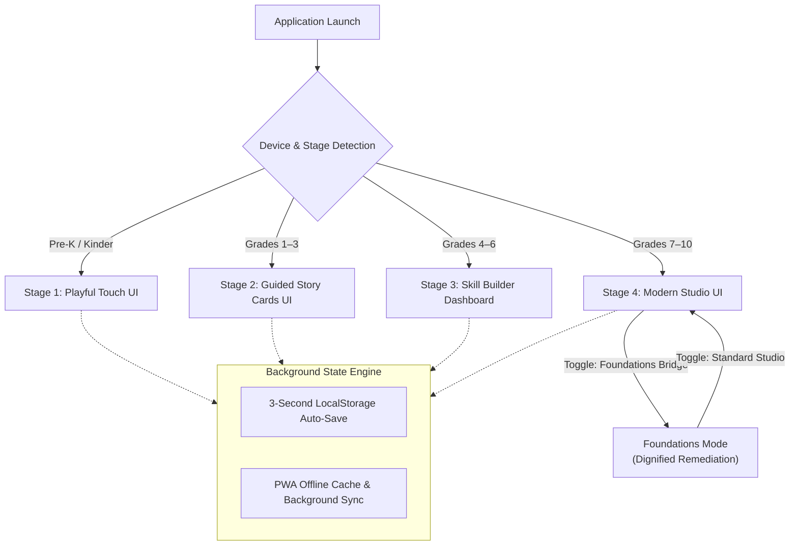
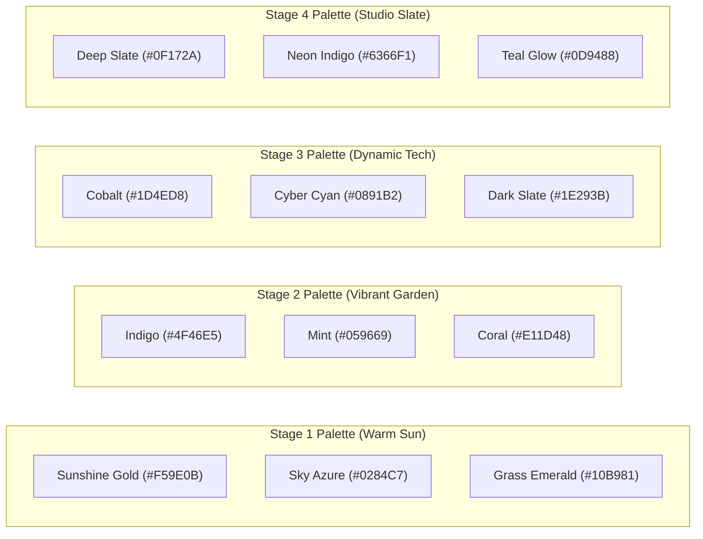
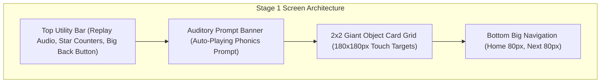
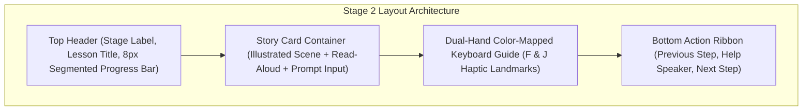
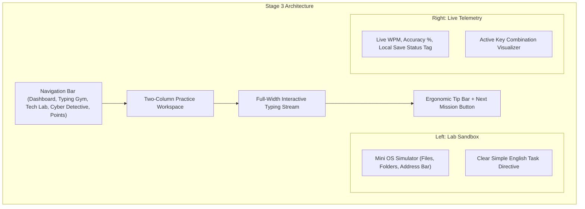
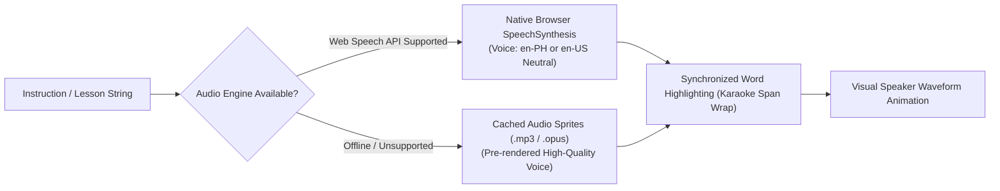
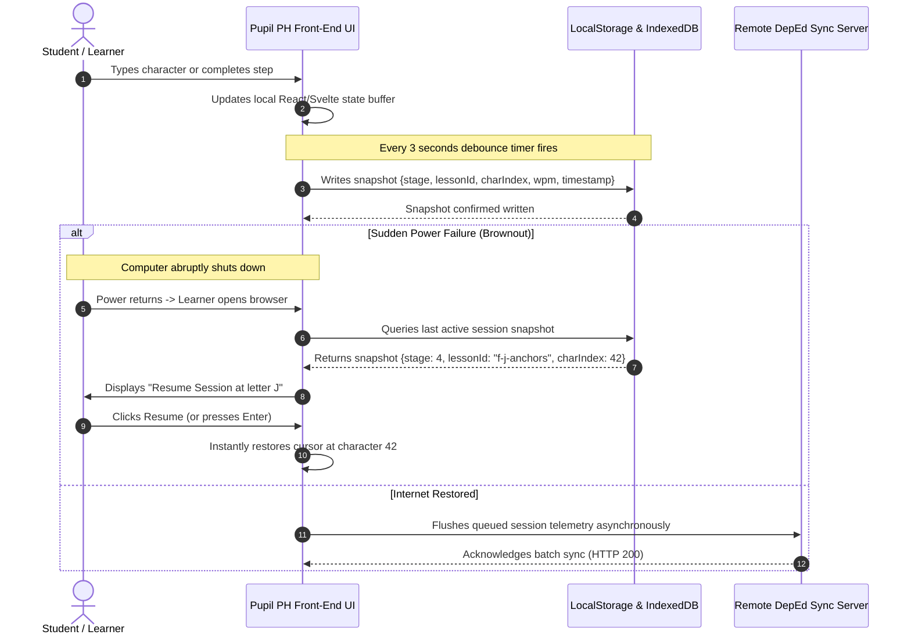

# Pupil PH: UI/UX & Interface Design Specifications
**Document Identifier:** `PUPIL-DOC-02`  
**Target Platform:** Responsive Web Application (Tablets, Laptops, Desktops)  
**Target Viewports:** 8-inch Android Tablets (`800x1280` / `1280x800`), 10-inch Tablets (`1200x1920`), Desktop Laptops/Monitors (`1366x768`, `1920x1080`)  
**Version:** 1.0.0  
**Status:** Approved Specification  

---

## 1. Global System Architecture & UX Principles

### 1.1 Architectural UX Foundations
1. **Zero Latency & 60 FPS Target:** Every interactive element—keystroke responses, touch ripples, card transitions, and progress bar increments—must execute within 16ms to avoid cognitive disengagement on budget hardware.
2. **Touch & Peripherals Parity:** The user interface seamlessly supports both primary touchscreens (fingers on budget Android tablets) and physical input devices (optical mouse and mechanical keyboard in computer laboratories).
3. **Glare & Ambient Sunlight Resistance:** Public school classrooms frequently feature open windows without curtains or air conditioning, causing extreme glare on reflective glass screens. The design system enforces WCAG AAA contrast ratios (minimum 7:1 for normal text and 4.5:1 for UI controls) and avoids subtle pastel-on-white text treatments.
4. **Resilient Brownout Recovery:** The UI maintains a persistent session anchor in `localStorage`/`IndexedDB`. If power fails or the browser closes unexpectedly, the application reopens to the exact active sentence without displaying an error dialog.



---

## 2. Design Tokens & Design System Fundamentals

### 2.1 Typography System
The typography uses **Lexend** (an open-source typeface scientifically designed to reduce visual crowding and enhance reading fluency for emergent and dyslexic readers) for body, instructions, and headlines. For high school coding and technical drills, **JetBrains Mono** is utilized.

```
+-----------------------------------------------------------------------------------+
|                               TYPOGRAPHY SCALE                                     |
+-----------------------------------------------------------------------------------+
|  TOKEN          | FONT SIZE | LINE HEIGHT | WEIGHT       | TYPICAL USE            |
|  --text-hero    | 48px (3rem)| 56px (1.16) | 800 (Bold)   | Stage 1 Big Letters    |
|  --text-title   | 32px (2rem)| 40px (1.25) | 700 (Bold)   | Stage 2/3 Unit Titles  |
|  --text-h1      | 24px(1.5rem)| 32px (1.33) | 600 (Semi)   | Stage 4 Screen Headers |
|  --text-h2      | 20px(1.25r)| 28px (1.40) | 600 (Semi)   | Card Titles, Modals    |
|  --text-body-lg | 18px(1.12r)| 28px (1.55) | 500 (Medium) | Stage 1/2 Story Text   |
|  --text-body    | 16px (1rem)| 24px (1.50) | 400 (Regular)| Stage 3/4 Descriptions |
|  --text-mono-lg | 20px(1.25r)| 28px (1.40) | 500 (Mono)   | Typing Practice Text   |
|  --text-mono    | 16px (1rem)| 24px (1.50) | 400 (Mono)   | Code & Shortcut Labels |
|  --text-sm      | 14px(.875r)| 20px (1.42) | 500 (Medium) | Metadata, Status Tags  |
+-----------------------------------------------------------------------------------+
```

### 2.2 Global Color Tokens & Stage Themes



#### Color Specification Table
| Token | Stage 1 (Pre-K/Kinder) | Stage 2 (Grades 1–3) | Stage 3 (Grades 4–6) | Stage 4 (Studio & Foundations) |
|---|---|---|---|---|
| `--color-primary` | `#F59E0B` (Amber 500) | `#4F46E5` (Indigo 600) | `#1D4ED8` (Blue 700) | `#6366F1` (Indigo 500) |
| `--color-primary-hover`| `#D97706` (Amber 600) | `#4338CA` (Indigo 700) | `#1E40AF` (Blue 800) | `#4F46E5` (Indigo 600) |
| `--color-surface` | `#FEF3C7` (Amber 50) | `#F8FAFC` (Slate 50) | `#F1F5F9` (Slate 100) | `#0F172A` (Slate 900) |
| `--color-card-bg` | `#FFFFFF` (Pure White) | `#FFFFFF` (Pure White) | `#FFFFFF` (Pure White) | `#1E293B` (Slate 800) |
| `--color-text-main` | `#1E293B` (Slate 800) | `#0F172A` (Slate 900) | `#0F172A` (Slate 900) | `#F8FAFC` (Slate 50) |
| `--color-text-muted`| `#475569` (Slate 600) | `#475569` (Slate 600) | `#334155` (Slate 700) | `#94A3B8` (Slate 400) |
| `--color-success` | `#10B981` (Emerald 500)| `#059669` (Emerald 600)| `#059669` (Emerald 600)| `#10B981` (Emerald 500)|
| `--color-border` | `#FCD34D` (Amber 300) | `#CBD5E1` (Slate 300) | `#94A3B8` (Slate 400) | `#334155` (Slate 700) |

### 2.3 Touch Target & Ergonomics Specifications
To guarantee error-free interaction across varied screen sizes and physical proficiencies:

| Interface Stage | Target Audience | Minimum Touch Target | Target Spacing / Gap | Target Click Target (Mouse) |
|---|---|---|---|---|
| **Stage 1 (Pre-K/Kinder)** | Ages 3–6 (Gross Motor) | **`64px × 64px`** (Recommended: `80px × 80px`) | `16px` minimum gap | `64px × 64px` |
| **Stage 2 (Grades 1–3)** | Ages 6–9 (Developing Fine) | **`48px × 48px`** (Recommended: `56px × 56px`) | `12px` minimum gap | `48px × 48px` |
| **Stage 3 (Grades 4–6)** | Ages 9–12 (Stabilized) | **`44px × 44px`** | `8px` minimum gap | `40px × 40px` |
| **Stage 4 (High School Studio)** | Ages 12–16+ (Mature) | **`40px × 40px`** | `8px` minimum gap | `36px × 36px` |

---

## 3. Stage 1: Playful Touch UI (Pre-School & Kindergarten | Ages 3–6)

### 3.1 UI Philosophy & Design Principles
* **Zero Text Dependency:** Navigation, instructions, and feedback are 100% accessible through high-contrast visual icons, large illustrated objects, and automatic audio voiceovers.
* **Large Tactile Surfaces:** Cards have `4px` thick borders, gentle elevations, and high-feedback physical press animations (`scale(0.96)` on tap).
* **Positive-Only Acoustic & Visual Feedback:** Mistakes produce no negative buzzer or harsh red flash; instead, the system emits a soft wooden click, and the target card gently pulses with a warm golden glow.

### 3.2 Screen Layout Wireframe

```
+-----------------------------------------------------------------------------------+
|  [PUPIL PH ICON]          [🔊 REPLAY VOICE (80x80px)]        [⭐ 5 STARS] [BACK]  |
+-----------------------------------------------------------------------------------+
|                                                                                   |
|                                [ BIG AUDIO BANNER ]                               |
|                     "Find the letter M for Mango!" (Voice auto-plays)              |
|                                                                                   |
|       +-----------------------+               +-----------------------+           |
|       |                       |               |                       |           |
|       |                       |               |                       |           |
|       |           M           |               |           B           |           |
|       |        [MANGO]        |               |       [BANANA]        |           |
|       |                       |               |                       |           |
|       +-----------------------+               +-----------------------+           |
|         (Target Card: 180x180px)                 (Target Card: 180x180px)          |
|                                                                                   |
|                                                                                   |
|       +-----------------------+               +-----------------------+           |
|       |                       |               |                       |           |
|       |           J           |               |           S           |           |
|       |       [JEEPNEY]       |               |        [STORE]        |           |
|       |                       |               |                       |           |
|       +-----------------------+               +-----------------------+           |
|                                                                                   |
+-----------------------------------------------------------------------------------+
|  [ 🏠 HOME (80px) ]                                         [ ➡️ NEXT (80px) ]    |
+-----------------------------------------------------------------------------------+
```



### 3.3 Component Specifications
1. **Giant Interactive Object Card:**
   * Dimensions: Minimum `180px × 180px` on tablets, `140px × 140px` on small screens.
   * Border: `4px solid #FCD34D` (Amber 300), background `#FFFFFF`, border-radius `24px` (`rounded-3xl`).
   * Shadow: `0 8px 0px #F59E0B` (Chunky flat 3D button appearance that looks pushable).
   * Active State: On touch down, transforms `translateY(4px)` with shadow reducing to `0 4px 0px`.
2. **Audio Read-Aloud Prompt Button:**
   * Dimensions: `80px × 80px`.
   * Icon: SVG loudspeaker with 3 expanding concentric soundwaves.
   * Behavior: Pulsates with an amber ripple animation (`scale(1.08)` loop) while audio is playing. Touching it re-triggers the prompt immediately.
3. **Celebration Overlay:**
   * Triggers after completing 4 successful taps.
   * Fullscreen modal with translucent warm overlay (`rgba(254, 243, 199, 0.85)`).
   * 3 bouncing stars with a soft marimba chime sound effect. Duration: 2.2 seconds before advancing automatically.

---

## 4. Stage 2: Guided Story Cards UI (Lower Elementary | Grades 1–3)

### 4.1 UI Philosophy & Design Principles
* **Card-Based Story Sequencing:** Lessons are delivered as step-by-step visual cards, creating an engaging story narrative (e.g., walking through a barangay, visiting a sari-sari store, packing a school bag).
* **Two-Hand Color Scaffolding:** An on-screen keyboard diagram maps left-hand keys to cool tones and right-hand keys to warm tones, training finger independence before touch typing is fully formed.
* **Auditory Support On-Demand:** Every text block includes a clickable speaker button (`48px`) allowing students to hear words pronounced in clear, slow English.

### 4.2 Screen Layout Wireframe

```
+-----------------------------------------------------------------------------------+
|  [PUPIL PH]  |  Lesson 2: At The Sari-Sari Store  |  [Progress: [=====    ] 50%]  |
+-----------------------------------------------------------------------------------+
|                                                                                   |
|  +-----------------------------------------------------------------------------+  |
|  |  STORY CARD (Height: 220px)                                                 |  |
|  |  +------------------------+  Aling Nena sells fresh food.                   |  |
|  |  |                        |  [🔊 Read Aloud (48px)]                         |  |
|  |  |    [ILLUSTRATION:      |                                                 |  |
|  |  |   Store Front & Rice]  |  Prompt: Type the word:                         |  |
|  |  |                        |  +-------------------------------------------+  |  |
|  |  +------------------------+  |  r  i  c  e  [CURSOR]                     |  |  |
|  |                              +-------------------------------------------+  |  |
|  +-----------------------------------------------------------------------------+  |
|                                                                                   |
|  ON-SCREEN DUAL-HAND KEYBOARD GUIDE                                               |
|  +-----------------------------------------------------------------------------+  |
|  |  [Q] [W] [E] [R] [T]       | (Center Line) |       [Y] [U] [I] [O] [P]      |  |
|  |  [A] [S] [D] [*F*] [G]     |               |       [H] [*J*] [K] [L] [;]    |  |
|  |  [Z] [X] [C] [V] [B]       |               |       [N] [M] [,] [.] [/]      |  |
|  |               [       SPACEBAR (Thumbs)       ]                             |  |
|  +-----------------------------------------------------------------------------+  |
|     (Left Hand: Coral/Blue Keys)                  (Right Hand: Mint/Teal Keys)    |
+-----------------------------------------------------------------------------------+
|  [ ⬅️ PREVIOUS CARD ]                                     [ ➡️ NEXT CARD ]         |
+-----------------------------------------------------------------------------------+
```



### 4.3 Component Specifications
1. **Interactive Prompt Box:**
   * Font: `Lexend`, `32px` font size, letter-spacing `4px`.
   * Active letter indicated by a vertical blinking cursor (`2px solid #4F46E5`).
   * Correctly typed letters turn `#059669` (Emerald 600) with a smooth checkmark icon.
   * An incorrect keystroke produces a subtle horizontal shake (`4px` left-right) and highlights the expected key on the keyboard guide below with an indigo pulse.
2. **On-Screen Keyboard Guide (Finger-Color Coded):**
   * Keys `A`, `S`, `D`, `F`: Left-hand zone (`#EEF2FF`, border `#6366F1`).
   * Keys `J`, `K`, `L`, `;`: Right-hand zone (`#ECFDF5`, border `#10B981`).
   * Keys `F` and `J` have a visible tactile dot indicator (`•`) in the center of the key.
   * Spacebar: Marked with dual-thumb icon (`#F1F5F9`, border `#94A3B8`).

---

## 5. Stage 3: Skill Builder Dashboard UI (Upper Elementary | Grades 4–6)

### 5.1 UI Philosophy & Design Principles
* **Empowered Agency:** Students navigate a modular mission dashboard featuring three core tracks: *Typing Gym*, *Computer Lab (Tech Literacy)*, and *Cyber Detective (Safety)*.
* **Real-Time Telemetry Without Stress:** Live WPM and accuracy counters are present but styled cleanly without flashing red sirens or countdown timers that induce panic.
* **Interactive Desktop Sandboxes:** Simulated web browser address bars, file explorer windows, and email drafting windows allow safe practice within the web app.

### 5.2 Screen Layout Wireframe

```
+-----------------------------------------------------------------------------------+
|  PUPIL PH  |  [Dashboard] [Typing Gym] [Tech Lab] [Cyber Detective]  | Mark (500 pts) |
+-----------------------------------------------------------------------------------+
|                                                                                   |
|  MISSION 3.2: FOLDER MANAGEMENT & SHORTCUTS                                       |
|                                                                                   |
|  +------------------------------------+  +-------------------------------------+  |
|  |  SIMULATED COMPUTER LAB WINDOW     |  |  LIVE MISSION METRICS               |  |
|  |  [📁 My Computer > Documents]      |  |                                     |  |
|  |  +------------------------------+  |  |  SPEED:     24 WPM                  |  |
|  |  | [📁 School Projects]         |  |  |  ACCURACY:  94%                     |  |
|  |  | [📁 Science Notes]           |  |  |  SAVED:     Yes (Local Safe)        |  |
|  |  | [📄 Barangay_Report.docx]    |  |  |                                     |  |
|  |  +------------------------------+  |  |  Shortcut Guide:                    |  |
|  |  Task: "Press Ctrl and S to save   |  |  [Ctrl] + [S] = Save File           |  |
|  |  the Barangay Report file now."    |  |  [Ctrl] + [C] = Copy                |  |
|  +------------------------------------+  +-------------------------------------+  |
|                                                                                   |
|  REAL-TIME TYPING EXERCISE ZONE                                                   |
|  +-----------------------------------------------------------------------------+  |
|  |  Always save your work before the power turns off. A sudden brownout will   |  |
|  |  erase unsaved files. Press Ctrl and S often to keep your work safe.        |  |
|  |  [==========================^.............................................]  |  |
|  +-----------------------------------------------------------------------------+  |
|                                                                                   |
+-----------------------------------------------------------------------------------+
|  [ 💡 TIP: Keep your wrists off the table desk while typing ]   [ SUBMIT EXERCISE ] |
+-----------------------------------------------------------------------------------+
```



### 5.3 Component Specifications
1. **Interactive Simulation Sandboxes:**
   * *File Explorer Module:* Lightweight interactive folder hierarchy. Students practice clicking "New Folder", typing a folder name ("Science"), and dragging simulated files into it.
   * *Browser Navigation Module:* Features an address bar with a lock icon (`🔒 https://`). Students identify authentic URLs vs. suspicious scam URLs.
2. **"Spot The Scam" Detective Card:**
   * Displays realistic mobile SMS or pop-up banners (e.g., *"Claim 1,000 pesos load now!"*).
   * Interaction: Two large decision buttons: `[ SCAM / NOT SAFE ]` (Green) and `[ SAFE / REAL ]` (Blue).
   * Detailed breakdown reveals visual red flags upon selection (e.g., unknown sender number, spelling error, urgent demands).

---

## 6. Stage 4: Modern Studio UI & "Foundations Bridge" Mode (Early High School | Grades 7–10)

### 6.1 UI Philosophy & Design Principles
* **Professional Studio Aesthetic:** Deep charcoal and dark slate background (`#0F172A`), sleek monospace typography (`JetBrains Mono`), and minimal distractions. It feels like VS Code, GitHub, or a professional terminal.
* **Zero Childish Elements:** No mascots, cartoon badges, or primary-colored buttons. High schoolers feel respected as young adults preparing for the workforce and higher education.
* **The "Foundations Bridge" Protocol:** A discrete toggle located in the main header enables older learners who lack elementary keyboard or reading skills to access core mechanics drills—without ever exposing them to lower-grade interfaces.

### 6.2 Screen Layout Wireframes

#### A. Standard Studio UI (High School Level)
```
+---------------------------------------------------------------------------------------------------------+
|  PUPIL STUDIO   [PROJECTS]  [TERMINAL]  [DOCS]  [SECURITY]  |  [MODE: STANDARD v]  | [⚙️] [Mark Santos] |
+---------------------------------------------------------------------------------------------------------+
|  [EXPLORER] |  WORKSPACE: document_analysis.txt                                        [LIVE: 38 WPM]   |
|  - main.py  |  +-------------------------------------------------------------------------------------+  |
|  - report   |  | In modern computer systems, keyboard shortcuts dramatically increase user           |  |
|  - data.csv |  | productivity. Mastering touch typing allows high school students to draft formal    |  |
|             |  | documents, write clean code, and navigate terminal commands without cognitive drag. |  |
|             |  | [cursor: _                                                                        ] |  |
|             |  +-------------------------------------------------------------------------------------+  |
|             |  TELEMETRY STREAM:                                                                        |
|             |  Gross Speed: 41 WPM  |  Net Speed: 38 WPM  |  Accuracy: 96.2%  |  Errors: 2 (Uncorrected)|
+-------------+-------------------------------------------------------------------------------------------+
|  STATUS: Connected | Buffer: Synced Local | Layout: US-QWERTY | Session Time: 14:22                     |
+---------------------------------------------------------------------------------------------------------+
```

#### B. Foundations Bridge Mode (Active in Studio UI)
```
+---------------------------------------------------------------------------------------------------------+
|  PUPIL STUDIO   [FOUNDATIONS TRACK]  [SHORTCUTS]  [SECURITY] | [MODE: FOUNDATIONS BRIDGE] | [Mark S.]   |
+---------------------------------------------------------------------------------------------------------+
|  MODULE 1.2: CORE ERGONOMIC MECHANICS                                                  [TARGET: 20 WPM] |
|  +---------------------------------------------------------------------------------------------------+  |
|  |  INSTRUCTION: Place left hand on A S D F. Place right hand on J K L ;                             |  |
|  |  Anchor your index fingers on the tactile bumps of F and J.                                        |  |
|  |                                                                                                   |  |
|  |  DRILL:  f f f   j j j   f j f   j f j   d k d   s l s   a ; a                                    |  |
|  |  INPUT:  f f f   j j j   f _                                                                      |  |
|  +---------------------------------------------------------------------------------------------------+  |
|                                                                                                         |
|  SLEEK MONOCHROME KEYBOARD GUIDE                                                                        |
|  +---------------------------------------------------------------------------------------------------+  |
|  |  [Tab]   [ Q ] [ W ] [ E ] [ R ] [ T ]   [ Y ] [ U ] [ I ] [ O ] [ P ]   [ [ ] [ ] ] [ \ ]        |  |
|  |  [Caps]  [ A ] [ S ] [ D ] [*F*] [ G ]   [ H ] [*J*] [ K ] [ L ] [ ; ]   [ ' ]       [Enter]      |  |
|  |  [Shift] [ Z ] [ X ] [ C ] [ V ] [ B ]   [ N ] [ M ] [ , ] [ . ] [ / ]   [ Shift ]                |  |
|  |          [Ctrl]  [Alt]   [             SPACEBAR             ]   [Alt]   [Ctrl]                    |  |
|  +---------------------------------------------------------------------------------------------------+  |
|  ACTIVE FINGERS: Left Index [F] | Right Index [J]  |  Posture: Flat wrists, elbows at 90 degrees         |
+---------------------------------------------------------------------------------------------------------+
|  STATUS: Foundations Active | Pacing: Precision Mode | Keystrokes Logged: 142 | Local Auto-Save: OK     |
+---------------------------------------------------------------------------------------------------------+
```

```mermaid
flowchart TD
    subgraph Stage4Studio["Stage 4 Studio Architecture"]
        StudioNav["Studio Header (Pupil Studio Logo, Tracks, Foundations Toggle, User Profile)"]
        subgraph ModeSwitch{"Foundations Toggle"}
            StandardTrack["Standard Track: Professional Terminal / Code / Prose Typing"]
            FoundationsTrack["Foundations Bridge: Core Mechanics (ASDF JKL;) in Dark Studio Theme"]
        end
        TelemetryStream["Telemetry Ribbon (Gross WPM, Net WPM, Accuracy %, Error Counts)"]
        StatusBar["Persistent Low-Profile Status Bar (IndexedDB Sync, US-QWERTY, Time)"]
    end
    StudioNav --> ModeSwitch
    StandardTrack --> TelemetryStream --> StatusBar
    FoundationsTrack --> TelemetryStream --> StatusBar
```

### 6.3 Foundations Bridge Mode: Detailed Interaction Specification
1. **The Mode Switcher Component:**
   * Location: Persistent in the top navigation header bar, right-aligned next to user settings.
   * Visual Presentation: A minimalist pill-shaped switch:  
     `[ Studio Standard | Foundations Bridge ]`
   * Transition: Seamless zero-reboot state shift (< 100ms). When switched, the practice text changes to home-row foundations, but the overall color scheme (dark slate `#0F172A`), fonts (`JetBrains Mono`), and high-tech telemetry remain identical.
2. **Keyboard Shortcut Activation:**
   * Pressing `Alt + F` instantly toggles Foundations Bridge mode on or off. A student can quietly switch without touching the mouse if a classmate walks by.
3. **Curriculum Mapping Inside Foundations Mode:**
   * *Phase F1: Tactile Landmarks & Home Row:* `F`, `J`, `Space`, `D`, `K`, `S`, `L`, `A`, `;`.
   * *Phase F2: Top & Bottom Row Reaches:* `E`, `I`, `R`, `U`, `T`, `Y`, `C`, `M`, `V`, `N`.
   * *Phase F3: Number & Punctuation Precision:* Numbers row, period, comma, quotation mark.
   * *Phase F4: Operational Combinations:* `Shift` + letter, `Ctrl + C`, `Ctrl + V`, `Ctrl + Z`, `Ctrl + S`.
   * *Phase F5: Mature Sentence Flow:* Short adult sentences (e.g., *"Open the browser window to find the train schedule."*).

---

## 7. Audio Read-Aloud & Text-to-Speech (TTS) Architecture



### 7.1 TTS Engine Rules by Stage
* **Stage 1 (Pre-K/Kinder):** Audio auto-plays on screen entry. High volume default (80%), speech rate set to `0.85x` (deliberate and clear). Replay button is `80px × 80px`.
* **Stage 2 (Grades 1–3):** Audio is available on demand via a prominent `48px` speaker button next to every sentence card. Speech rate set to `0.90x`.
* **Stage 3 (Grades 4–6):** Audio is available on demand via a `40px` speaker button. Speech rate set to `1.0x` (normal conversational speed).
* **Stage 4 (Grades 7–10):** Audio is accessible via an discrete headphones icon or shortcut (`Alt + A`). Speech rate `1.0x`.

### 7.2 Synchronized Karaoke Highlighting
When audio read-aloud is active, the text is tokenized into word spans:
```html
<p class="reading-prompt">
  <span class="word-token active-reading">Save</span>
  <span class="word-token">your</span>
  <span class="word-token">file</span>
  <span class="word-token">now.</span>
</p>
```
* **Active Word Styling:** Background `#FEF08A` (Yellow 200), color `#0F172A`, font-weight `700`, smooth transition `120ms`.
* Provides immediate dual-sensory reinforcement (visual + auditory) to build word decoding and sight recognition.

### 7.3 Auditory Sound Effects (SFX) Palette
To eliminate anxiety while providing distinct mechanical feedback:
* **Correct Keystroke:** Soft wooden tick (`40ms`, subtle, pitch-randomized ±5% to avoid fatigue).
* **Incorrect Keystroke:** Gentle low-frequency wooden tap (`60ms`, `180Hz`, non-punitive, no harsh buzzer).
* **Lesson / Unit Complete:** Melodic three-note rising chime (`C5 -> E5 -> G5`, marimba/xylophone timbre, duration `800ms`).

---

## 8. Asset, Art & Iconography Guidelines

### 8.1 Visual Style Principles
1. **Lightweight Vector-Only (SVG):** All icons, illustrations, and UI graphics must be scalable vector graphics (SVG) or pure CSS shapes. No heavy unoptimized PNG/JPEG files.
2. **Philippine Cultural Authenticity:**
   * Vehicles: True-to-life Philippine utility jeepneys and tricycles (avoid generic American school buses).
   * Fauna & Flora: Carabao, Philippine eagle, mango trees, banana leaves.
   * Architecture: Rural and suburban *sari-sari* stores, wooden houses with tin roofs, barangay halls with basketball courts, and public school computer laboratories with uniform desktop rows.
   * People: Filipino skin tones, school uniforms (white polo shirts with blue/green slacks or skirts).
3. **High Contrast for Open Classrooms:** Avoid faint pastel lines. All SVG artwork must feature distinct outer strokes (`2px` to `3px` solid `#1E293B`) to remain crisp under direct sunlight.

---

## 9. Comprehensive Design Tokens (CSS Custom Properties)

Below is the production-ready CSS variable dictionary to be used by the front-end engineering team:

```css
:root {
  /* ==========================================================================
     GLOBAL SPACING & LAYOUT GRID (4px / 8px Baseline)
     ========================================================================== */
  --space-1: 4px;
  --space-2: 8px;
  --space-3: 12px;
  --space-4: 16px;
  --space-5: 20px;
  --space-6: 24px;
  --space-8: 32px;
  --space-10: 40px;
  --space-12: 48px;
  --space-16: 64px;

  /* ==========================================================================
     GLOBAL BORDER RADII
     ========================================================================== */
  --radius-sm: 4px;
  --radius-md: 8px;
  --radius-lg: 12px;
  --radius-xl: 16px;
  --radius-2xl: 24px;
  --radius-full: 9999px;

  /* ==========================================================================
     UNIVERSAL FUNCTIONAL FEEDBACK TOKENS
     ========================================================================== */
  --feedback-success: #10B981;
  --feedback-success-bg: #ECFDF5;
  --feedback-warning: #F59E0B;
  --feedback-warning-bg: #FFFBEB;
  --feedback-error: #EF4444;
  --feedback-error-bg: #FEF2F2;
  --feedback-info: #0284C7;
  --feedback-info-bg: #F0F9FF;

  /* ==========================================================================
     STAGE 1 THEME: PLAYFUL TOUCH (Pre-K & Kindergarten)
     ========================================================================== */
  --s1-primary: #F59E0B;
  --s1-primary-active: #D97706;
  --s1-bg: #FEF3C7;
  --s1-card: #FFFFFF;
  --s1-border: #FCD34D;
  --s1-text: #1E293B;
  --s1-touch-min: 64px;
  --s1-touch-target: 80px;

  /* ==========================================================================
     STAGE 2 THEME: GUIDED STORY CARDS (Grades 1–3)
     ========================================================================== */
  --s2-primary: #4F46E5;
  --s2-primary-active: #4338CA;
  --s2-bg: #F8FAFC;
  --s2-card: #FFFFFF;
  --s2-border: #CBD5E1;
  --s2-text: #0F172A;
  --s2-touch-min: 48px;
  --s2-touch-target: 56px;

  /* ==========================================================================
     STAGE 3 THEME: SKILL BUILDER DASHBOARD (Grades 4–6)
     ========================================================================== */
  --s3-primary: #1D4ED8;
  --s3-primary-active: #1E40AF;
  --s3-bg: #F1F5F9;
  --s3-card: #FFFFFF;
  --s3-border: #94A3B8;
  --s3-text: #0F172A;
  --s3-touch-min: 44px;
  --s3-touch-target: 44px;

  /* ==========================================================================
     STAGE 4 THEME: MODERN STUDIO & FOUNDATIONS BRIDGE (Grades 7–10)
     ========================================================================== */
  --s4-primary: #6366F1;
  --s4-primary-active: #4F46E5;
  --s4-bg: #0F172A;
  --s4-card: #1E293B;
  --s4-card-hover: #334155;
  --s4-border: #334155;
  --s4-text: #F8FAFC;
  --s4-text-muted: #94A3B8;
  --s4-accent-teal: #14B8A6;
  --s4-touch-min: 40px;
  --s4-touch-target: 40px;
}
```

---

## 10. Brownout / Auto-Save State Flowchart



---

## 11. Engineering Checklist for Implementation
- [ ] Ensure all SVGs are inlined or loaded from cached sprites (no external CDN calls).
- [ ] Enforce touch target minimums in CSS: `min-width: var(--s1-touch-min); min-height: var(--s1-touch-min);`.
- [ ] Verify Flesch-Kincaid read-out checks pass on all lesson strings before bundling.
- [ ] Validate Service Worker caches 100% of curriculum JSON data on initial installation.
- [ ] Verify that `Alt + F` switches into Foundations Bridge Mode without layout reflow or page reload.
- [ ] Ensure zero Tagalog words exist across all UI string resource bundles.
