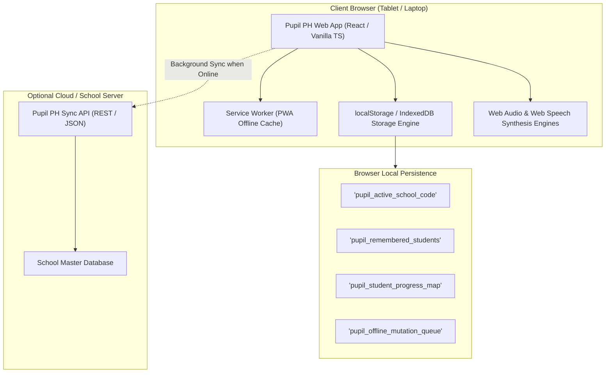
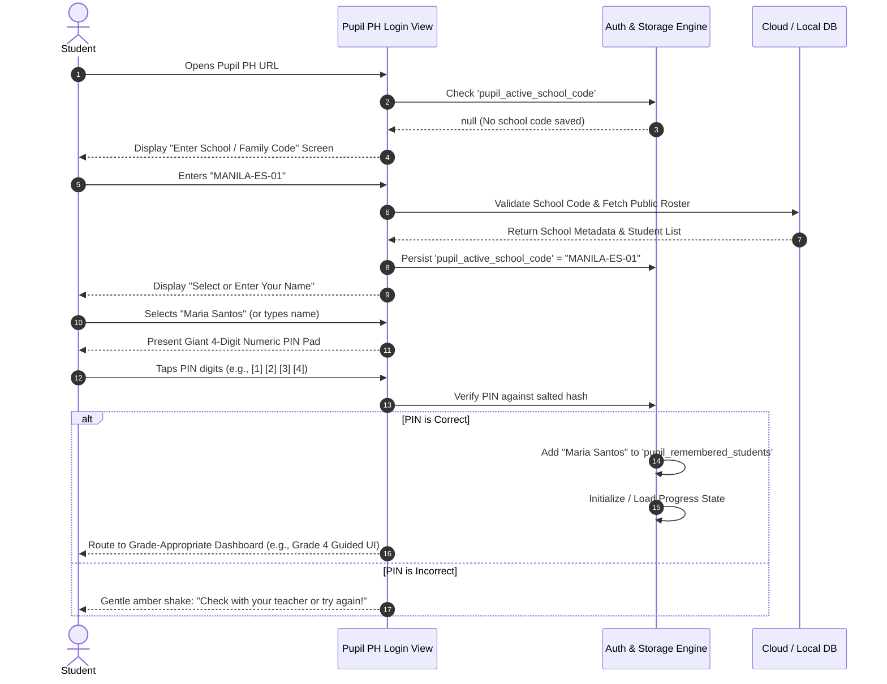
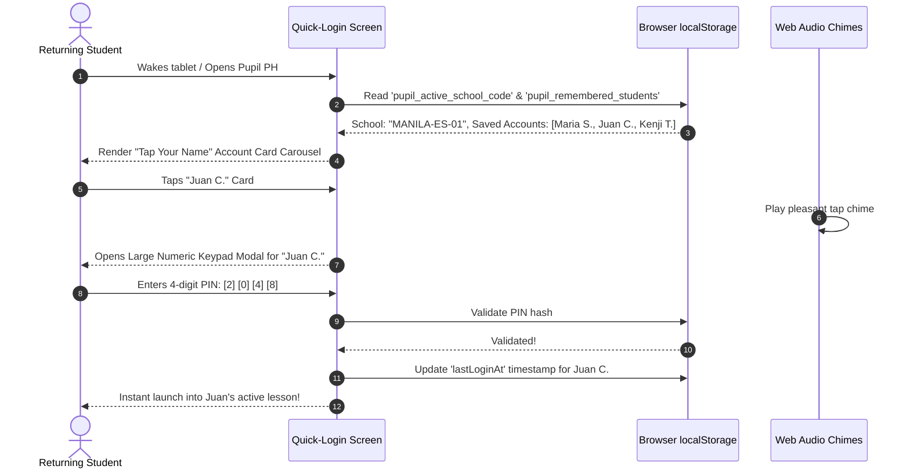
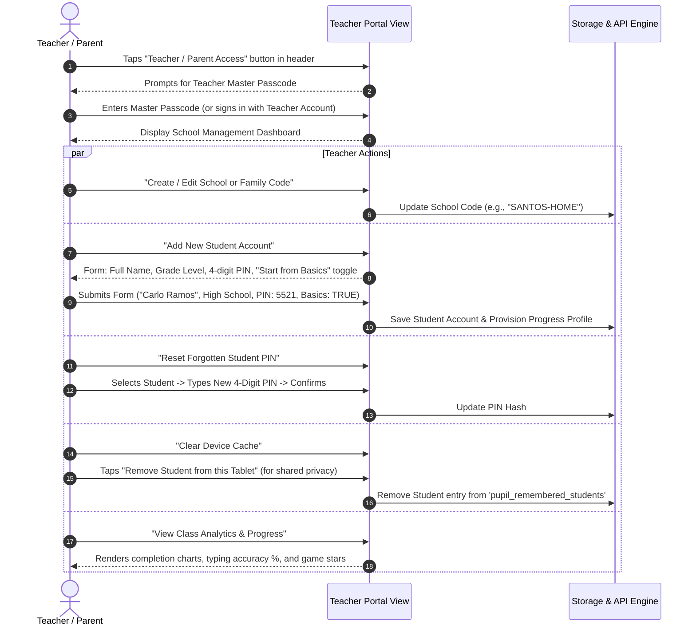
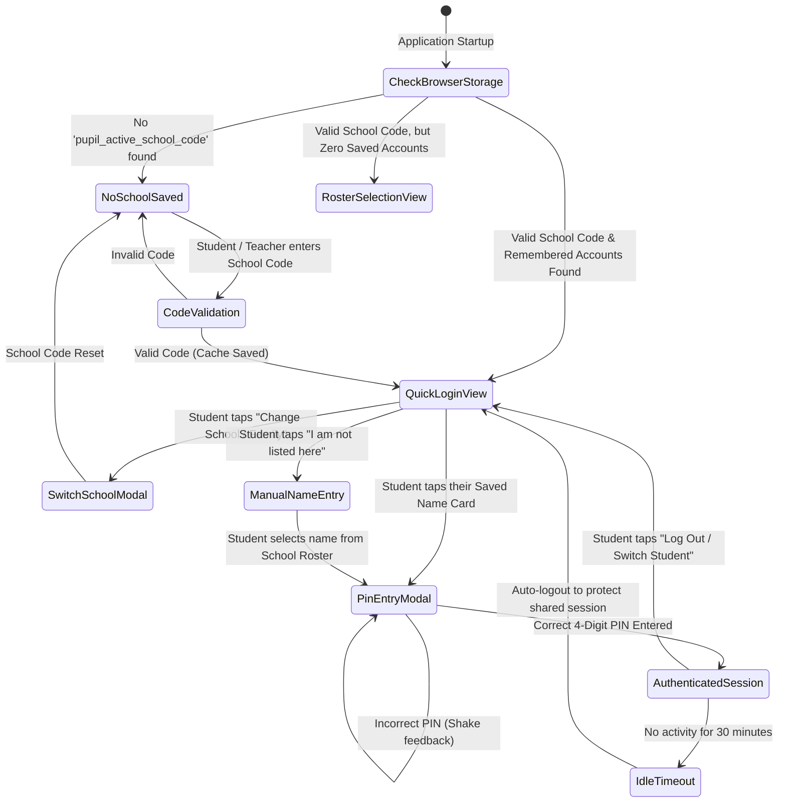
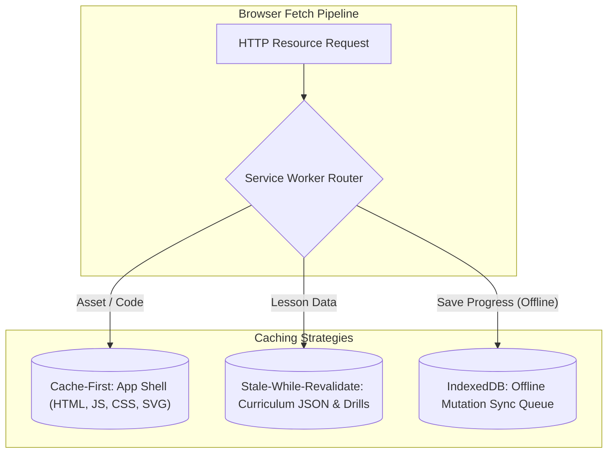

# Pupil PH — System Architecture, Authentication & Persistence Specification
**Document ID:** `SPEC-01-SYSTEM-AUTH-PERSIST`  
**Version:** 1.0.0  
**Target Environments:** Modern Web Browsers (Chrome 90+, Edge 90+, Safari 14+, Firefox 88+) on Tablets and Laptops/Desktops  
**Language Rule:** Pure Simple English Only (No Tagalog Translations)

---

## 1. System Architectural Overview

### 1.1 Context & Realities in Philippine Classrooms
In the Philippines, public elementary and high school computer laboratories and mobile tablet carts face unique real-world operational challenges:
1. **Shared Devices Across Class Periods**: A single tablet or computer is shared by 5 to 8 different students every school day across varying grade levels.
2. **Strict Time Limits**: Computer classes typically last 45 to 60 minutes. Traditional authentication requiring email addresses and long alphanumeric passwords consumes 15 to 20 minutes of instructional time simply logging in.
3. **Intermittent or High-Latency Connectivity**: School internet access frequently disconnects or throttles. The web application must load instantly, persist student credentials locally, and operate fully offline once cached.
4. **Varied Student Technical Readiness**: Younger students (Pre-K to Grade 3) cannot type complex strings reliably, but they can easily identify their name and enter a simple 4-digit PIN.

### 1.2 High-Level Architectural Diagram



---

## 2. Authentication, Browser Persistence & Session Lifecycle

### 2.1 The Three-Pillar Authentication Strategy
To eliminate friction while preserving individual student privacy and data segregation, Pupil PH utilizes a **Three-Pillar Authentication Strategy**:
1. **School / Family Code**: A human-friendly alphanumeric identifier (e.g., `MANILA-ES-01`, `SANTOS-HOME`, `MALOLOS-G4`) that groups a roster of students.
2. **Student Name / Avatar Profile**: A student’s registered first name or full name associated with their Grade Level (`preschool`, `elem_lower`, `elem_upper`, `highschool`) and their High School "Start from Basics" flag.
3. **4-Digit Numeric PIN (`0000`–`9999`)**: A memorable 4-digit numeric code known only to the student, their teacher, and their parents.

### 2.2 Browser Persistence Model for Easy Kid Login
Whenever a student successfully logs in on a shared tablet or laptop:
1. The **School / Family Code** is saved to `localStorage` under `pupil_active_school_code`.
2. The student's public card information (`studentId`, `displayName`, `avatarId`, `gradeLevel`, `isHighSchoolFoundations`, and `lastLoginAt`) is appended to the browser's `pupil_remembered_students` roster array (max 20 accounts per device, LRU eviction).
3. **Security Principle**: The 4-digit PIN is **NEVER** stored in plaintext inside `localStorage`. Instead, a local cryptographic hash (PBKDF2-SHA256 with a unique salt) or a signed session token is stored. When the student returns, they simply tap their card and enter their 4-digit PIN to authenticate immediately!

---

### 2.3 User Flow 1: First-Time Student Login on a Shared Browser



---

### 2.4 User Flow 2: Returning Student Quick-Login ("Tap Your Name")

When returning students pick up a tablet in class, they bypass the school code entry entirely:



---

### 2.5 User Flow 3: Teacher & Parent Account Management Portal



---

### 2.6 State Machine: Student Authentication Lifecycle



---

## 3. Data Models & JSON Schemas

### 3.1 TypeScript Core Interfaces (`src/types/system.ts`)

```typescript
/**
 * Supported Student Grade Levels
 */
export type GradeLevel = 'preschool' | 'elem_lower' | 'elem_upper' | 'highschool';

/**
 * Adaptive UI Visual Modes across the 4 Grade Stages
 */
export type InterfaceMode = 'playful' | 'guided' | 'dashboard' | 'studio';

/**
 * School or Family Group Account
 */
export interface SchoolGroup {
  /** Unique alphanumeric identifier (e.g. "MANILA-ES-01", "SANTOS-HOME") */
  schoolCode: string;
  /** Human-readable institution or household name */
  displayName: string;
  /** Contact email of the supervising teacher or parent administrator */
  adminEmail: string;
  /** Salted hash of teacher master passcode */
  adminPasscodeHash: string;
  /** ISO 8601 creation timestamp */
  createdAt: string;
  /** Maximum allowed student roster size under this code */
  maxStudents: number;
}

/**
 * Individual Student Account
 */
export interface StudentAccount {
  /** Unique UUID v4 identifier */
  studentId: string;
  /** Associated School or Family Code */
  schoolCode: string;
  /** First name or full display name */
  displayName: string;
  /** Assigned learning grade level */
  gradeLevel: GradeLevel;
  /** Flag for High School students requiring foundational bridge materials in Studio Mode */
  isHighSchoolFoundations: boolean;
  /** Cryptographic PBKDF2/SHA-256 hash of the 4-digit PIN */
  pinHash: string;
  /** Cryptographic salt used for PIN hashing */
  pinSalt: string;
  /** Avatar identifier for playful kid identification (e.g. "tarsier", "jeepney", "mango") */
  avatarId: string;
  /** ISO 8601 timestamp of account creation */
  createdAt: string;
  /** ISO 8601 timestamp of last login */
  lastLoginAt: string;
}

/**
 * Browser Local Persistence Record ('pupil_remembered_students')
 * Stores non-sensitive public card info for one-tap quick login.
 */
export interface RememberedStudentCard {
  studentId: string;
  schoolCode: string;
  displayName: string;
  gradeLevel: GradeLevel;
  isHighSchoolFoundations: boolean;
  avatarId: string;
  lastLoginAt: string;
}

/**
 * Browser Local State Container ('pupil_browser_state')
 */
export interface RememberedBrowserState {
  activeSchoolCode: string | null;
  savedAccounts: RememberedStudentCard[];
  deviceNickname?: string;
  soundEnabled: boolean;
  slowSpeechEnabled: boolean;
  highContrastMode: boolean;
}

/**
 * Comprehensive Student Progress Record
 */
export interface UserProgress {
  studentId: string;
  /** Array of completed Lesson IDs across Tech Literacy and English */
  completedLessons: string[];
  /** Detailed typing stage and drill performance */
  typingProgress: {
    unlockedStage: number; // 1 to 6
    completedDrills: {
      [drillId: string]: {
        accuracy: number; // 0 to 100 percentage
        wpm?: number;
        completedAt: string;
        starsEarned: number; // 1 to 3 stars
      };
    };
  };
  /** Mini-game high scores and achievements */
  gameScores: {
    jeepneyWordExpress: {
      highScore: number;
      starsTotal: number;
      roundsCompleted: number;
    };
    mangoCatcher: {
      highScore: number;
      maxStreak: number;
      roundsCompleted: number;
    };
    sentenceBuilder: {
      solvedSentences: string[];
      starsTotal: number;
    };
    techDetective: {
      solvedMissions: string[];
      badgesEarned: string[];
    };
  };
  totalPoints: number;
  currentStreakDays: number;
  lastActiveDate: string;
}

/**
 * Generic Lesson Definition (Tech Literacy / Basic English)
 */
export interface Lesson {
  lessonId: string;
  level: GradeLevel;
  title: string;
  category: 'tech_literacy' | 'basic_english';
  isFoundationBridge?: boolean;
  summary: string;
  slides: {
    slideId: string;
    headline: string;
    bodyText: string;
    illustrationKey: string;
    ttsAudioText: string;
  }[];
  quiz: {
    questionId: string;
    questionText: string;
    ttsAudioText: string;
    options: string[];
    correctIndex: number;
    explanation: string;
  }[];
}

/**
 * Typing Drill Definition
 */
export interface TypingDrill {
  drillId: string;
  stageNumber: number; // 1 to 6
  title: string;
  focusKeys: string[];
  targetText: string;
  pedagogicalGoal: string;
  promptInstruction: string;
  ttsPrompt: string;
}

/**
 * Mini-Game Score Submission Result
 */
export interface GameResult {
  gameId: 'jeepney_word_express' | 'mango_catcher' | 'sentence_scramble' | 'tech_detective';
  studentId: string;
  timestamp: string;
  score: number;
  accuracyPercentage?: number;
  streakAchieved?: number;
  starsAwarded: number;
  isNewPersonalBest: boolean;
}
```

---

### 3.2 Formal JSON Schema: Student Account (`schemas/student-account.json`)

```json
{
  "$schema": "http://json-schema.org/draft-07/schema#",
  "title": "StudentAccount",
  "type": "object",
  "required": [
    "studentId",
    "schoolCode",
    "displayName",
    "gradeLevel",
    "isHighSchoolFoundations",
    "pinHash",
    "pinSalt",
    "avatarId",
    "createdAt"
  ],
  "properties": {
    "studentId": {
      "type": "string",
      "format": "uuid"
    },
    "schoolCode": {
      "type": "string",
      "pattern": "^[A-Z0-9_-]{3,20}$"
    },
    "displayName": {
      "type": "string",
      "minLength": 2,
      "maxLength": 50
    },
    "gradeLevel": {
      "type": "string",
      "enum": ["preschool", "elem_lower", "elem_upper", "highschool"]
    },
    "isHighSchoolFoundations": {
      "type": "boolean"
    },
    "pinHash": {
      "type": "string",
      "minLength": 32
    },
    "pinSalt": {
      "type": "string",
      "minLength": 16
    },
    "avatarId": {
      "type": "string",
      "enum": ["tarsier", "jeepney", "mango", "carabao", "eagle", "laptop", "star"]
    },
    "createdAt": {
      "type": "string",
      "format": "date-time"
    },
    "lastLoginAt": {
      "type": "string",
      "format": "date-time"
    }
  },
  "additionalProperties": false
}
```

---

### 3.3 Formal JSON Schema: User Progress (`schemas/user-progress.json`)

```json
{
  "$schema": "http://json-schema.org/draft-07/schema#",
  "title": "UserProgress",
  "type": "object",
  "required": [
    "studentId",
    "completedLessons",
    "typingProgress",
    "gameScores",
    "totalPoints"
  ],
  "properties": {
    "studentId": {
      "type": "string",
      "format": "uuid"
    },
    "completedLessons": {
      "type": "array",
      "items": { "type": "string" }
    },
    "typingProgress": {
      "type": "object",
      "required": ["unlockedStage", "completedDrills"],
      "properties": {
        "unlockedStage": {
          "type": "integer",
          "minimum": 1,
          "maximum": 6
        },
        "completedDrills": {
          "type": "object",
          "additionalProperties": {
            "type": "object",
            "required": ["accuracy", "completedAt", "starsEarned"],
            "properties": {
              "accuracy": { "type": "number", "minimum": 0, "maximum": 100 },
              "wpm": { "type": "number", "minimum": 0 },
              "completedAt": { "type": "string", "format": "date-time" },
              "starsEarned": { "type": "integer", "minimum": 1, "maximum": 3 }
            }
          }
        }
      }
    },
    "gameScores": {
      "type": "object",
      "required": ["jeepneyWordExpress", "mangoCatcher", "sentenceBuilder", "techDetective"],
      "properties": {
        "jeepneyWordExpress": {
          "type": "object",
          "required": ["highScore", "starsTotal", "roundsCompleted"],
          "properties": {
            "highScore": { "type": "integer", "minimum": 0 },
            "starsTotal": { "type": "integer", "minimum": 0 },
            "roundsCompleted": { "type": "integer", "minimum": 0 }
          }
        },
        "mangoCatcher": {
          "type": "object",
          "required": ["highScore", "maxStreak", "roundsCompleted"],
          "properties": {
            "highScore": { "type": "integer", "minimum": 0 },
            "maxStreak": { "type": "integer", "minimum": 0 },
            "roundsCompleted": { "type": "integer", "minimum": 0 }
          }
        },
        "sentenceBuilder": {
          "type": "object",
          "required": ["solvedSentences", "starsTotal"],
          "properties": {
            "solvedSentences": { "type": "array", "items": { "type": "string" } },
            "starsTotal": { "type": "integer", "minimum": 0 }
          }
        },
        "techDetective": {
          "type": "object",
          "required": ["solvedMissions", "badgesEarned"],
          "properties": {
            "solvedMissions": { "type": "array", "items": { "type": "string" } },
            "badgesEarned": { "type": "array", "items": { "type": "string" } }
          }
        }
      }
    },
    "totalPoints": {
      "type": "integer",
      "minimum": 0
    },
    "currentStreakDays": {
      "type": "integer",
      "minimum": 0
    },
    "lastActiveDate": {
      "type": "string",
      "format": "date"
    }
  },
  "additionalProperties": false
}
```

---

## 4. Performance & Device Optimization Requirements

```
TARGET HARDWARE CONSTRAINTS (PHILIPPINE SCHOOLS)
┌─────────────────────────────────────────────────────────────┐
│ • Tablets: Low-cost Android 9–13 (Unisoc / MediaTek, 2GB RAM) │
│ • PCs: Refurbished Intel Core i3 / Celeron, 4GB RAM         │
│ • Network: Intermittent 3G / 4G pocket Wi-Fi (often < 1 Mbps) │
└─────────────────────────────────────────────────────────────┘
```

### 4.1 Strict Bundle Size & Asset Budgets
To ensure rapid page loads on congested rural school Wi-Fi and budget cellular tethering:
- **Maximum Initial JS Bundle**: $\le 120\text{ KB}$ (gzipped / brotli).
- **Maximum Initial CSS Bundle**: $\le 30\text{ KB}$ (gzipped).
- **Asset Formats**:
  - **Vector Illustrations**: Strictly inline SVG or compressed SVG files. **Zero external PNG/JPEG asset packs** for UI controls or game objects.
  - **3D Libraries Disallowed**: No Three.js, Babylon.js, or heavyweight game engines (Phaser). Mini-games are implemented using lightweight HTML5 Canvas ($<15\text{ KB}$ wrapper) or direct SVG DOM nodes.
  - **Zero External Fonts**: Use high-legibility system font stacks:
    ```css
    font-family: -apple-system, BlinkMacSystemFont, "Segoe UI", Roboto, "Helvetica Neue", Arial, sans-serif;
    ```

---

### 4.2 Progressive Web App (PWA) & Service Worker Caching Strategy



#### Service Worker Implementation Specification (`public/sw.js`)
1. **App Shell (Cache-First)**:
   - Cache name: `pupil-shell-v1`
   - Pre-caches `index.html`, bundle scripts, SVG icons, and stylesheets during the Service Worker `install` event.
   - Serves immediately from cache; never blocks the UI on an offline connection.
2. **Curriculum & Drill Data (Stale-While-Revalidate)**:
   - Cache name: `pupil-data-v1`
   - Delivers cached lessons instantly while silently fetching updates in the background.
3. **Offline Mutation Queue (IndexedDB)**:
   - When a student finishes a lesson or mini-game while offline:
     1. The progress is saved immediately to local IndexedDB.
     2. An event is appended to `pupil_offline_mutation_queue`.
     3. When `window.addEventListener('online', ...)` triggers, the sync queue flushes stored progress back to the school server with exponential backoff retry.
4. **100% Offline Operability**:
   - Once a device visits Pupil PH for the first time, all 6 typing stages, all 4 mini-games, and all core literacy modules must remain fully playable without an active internet connection.

---

### 4.3 Web Audio API & Web Speech API Synthesis Specifications

#### Web Audio API Synthesis Specs
- **Procedural Audio Only**: Sound effects are generated mathematically using `AudioContext`, `OscillatorNode`, and `GainNode`.
- **Latency Budget**: Keystroke sound response time must remain under $15\text{ ms}$ on mobile ARM processors.
- **Auto-Resume Policy**: To comply with browser autoplay policies:
  ```typescript
  window.addEventListener('pointerdown', () => {
    if (audioCtx.state === 'suspended') {
      audioCtx.resume();
    }
  }, { once: true });
  ```

#### Web Speech API TTS Integration
- **Engine**: Native `window.speechSynthesis` with `SpeechSynthesisUtterance`.
- **Voice Selection Priority**:
  1. Philippine English voice (`en-PH`) if installed on the host OS.
  2. Standard US English (`en-US`) with clear neutral diction.
  3. Default browser system English voice.
- **Rate & Pitch Calibration**:
  - `rate: 0.85` for Pre-School and Elementary learners (allows students to distinguish distinct phonemes).
  - `rate: 1.0` for Early High School Studio Mode.
  - `pitch: 1.05` (warm and welcoming tone).
- **Graceful Fallback**: If the browser lacks speech synthesis support (e.g., restricted webviews), a clean visual subtitle balloon appears in place of spoken audio.

---

### 4.4 Tablet Viewport, Touch Ergonomics & Responsive Breakpoints

```
BREAKPOINT ARCHITECTURE
┌──────────────────────────┬──────────────────────────┬──────────────────────────┐
│ Small Tablet / Phablet   │ Standard Tablet          │ Laptop / Desktop PC      │
│ (600px – 768px)          │ (768px – 1024px)         │ (> 1024px)               │
├──────────────────────────┼──────────────────────────┼──────────────────────────┤
│ Single-column stack      │ 2-column split           │ Full dashboard grid      │
│ Floating PIN modal       │ Embedded PIN drawer      │ Centered modal card      │
│ Mini Virtual Keyboard    │ Full 56px Touch QWERTY   │ Physical Keyboard Focus  │
└──────────────────────────┴──────────────────────────┴──────────────────────────┘
```

#### Touch Ergonomics Rules
1. **Minimum Touch Targets**: All interactive buttons, cards, and on-screen keyboard keys must meet or exceed $48 \times 48\text{ CSS px}$ ($56 \times 56\text{ px}$ recommended for primary action triggers).
2. **Spacing & Padding**: Minimum $8\text{ px}$ separation between adjacent touch hitboxes to prevent accidental mis-taps by younger learners with developing fine motor control.
3. **Safe-Area Insets**: Full layout padding respects device notches and navigation bars:
   ```css
   padding-top: env(safe-area-inset-top, 16px);
   padding-bottom: env(safe-area-inset-bottom, 16px);
   padding-left: env(safe-area-inset-left, 16px);
   padding-right: env(safe-area-inset-right, 16px);
   ```
4. **Virtual Keyboard Handling**:
   - Prevent mobile browser zoom on double-tap:
     ```html
     <meta name="viewport" content="width=device-width, initial-scale=1.0, maximum-scale=1.0, user-scalable=no, interactive-widget=resizes-content">
     ```
   - When the native soft keyboard opens on mobile devices, use the `window.visualViewport` API to dynamically scroll the active input field into center view.
5. **Accessibility & Contrast**:
   - All body text and buttons must achieve a contrast ratio of $\ge 4.5:1$ against backgrounds (WCAG 2.1 AA).
   - High-contrast mode toggle available in the header settings for visually impaired students.

---

## 5. Security & Privacy Guarantees

1. **COPPA & Philippine Data Privacy Act (DPA 2012) Alignment**:
   - Pupil PH does not collect student home addresses, phone numbers, or facial biometric data.
   - Student identities are referenced only by their First Name / School Roster Nickname and an assigned 4-digit numeric PIN.
2. **PIN Protection in Storage**:
   - The browser never writes cleartext PINs to `localStorage` or `IndexedDB`.
   - PIN hashes are computed locally using PBKDF2 with 10,000 iterations:
     $$\text{pinHash} = \text{PBKDF2-HMAC-SHA256}(\text{pin}, \text{salt}, 10000)$$
3. **Local Device Roster Privacy**:
   - A one-click `"Remove Student from this Tablet"` button allows teachers or students to purge their remembered account card from a shared device when changing classrooms.

---

## 6. Implementation Verification Checklist

- [x] Three-Pillar authentication model fully defined (School Code + Name + 4-Digit PIN).
- [x] First-time login sequence diagram with browser persistence specified.
- [x] Returning student one-tap quick-login workflow with giant numeric PIN pad detailed.
- [x] Complete Teacher/Parent Portal administrative lifecycle diagrammed.
- [x] Comprehensive TypeScript interfaces and formal JSON schemas defined.
- [x] Sub-120 KB bundle size budget and zero external asset dependency rules established.
- [x] PWA offline caching and Service Worker synchronization strategy documented.
- [x] Web Audio API procedural synthesis and Web Speech API TTS rate/voice specs written.
- [x] Tablet touch ergonomics ($56\text{ px}$ hitboxes, `visualViewport` handling) specified.
- [x] Full compliance with Pure Simple English constraint (No Tagalog translations).
