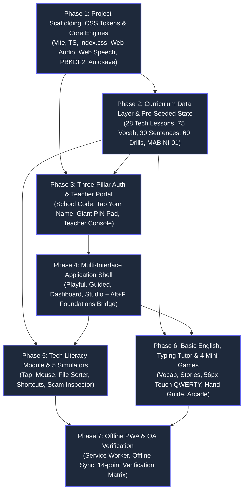
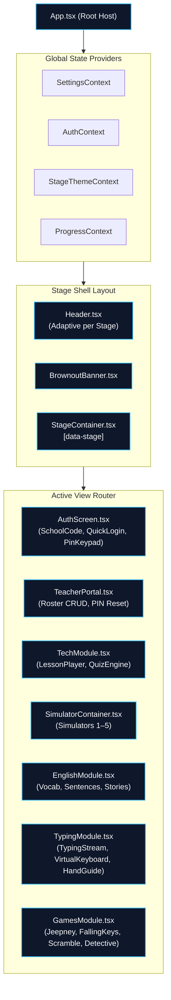
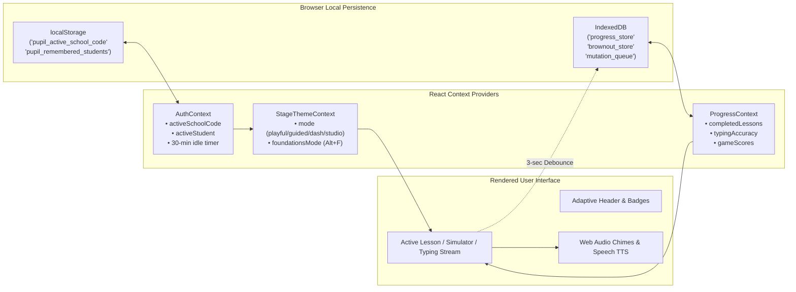
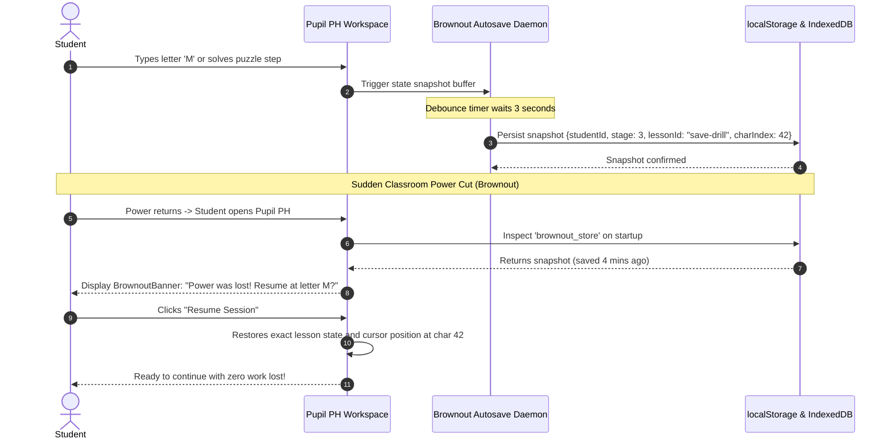
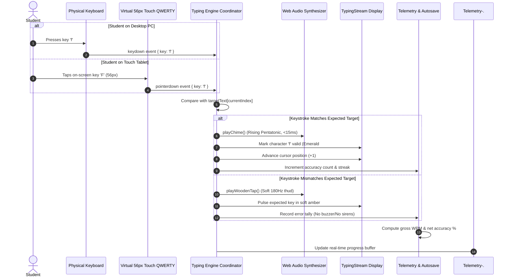

# Pupil PH — Master Application Implementation Plan
**Document ID:** `SPEC-02-IMPLEMENTATION-PLAN`  
**Version:** 1.0.0  
**Target Environments:** Modern Web Browsers (Chrome 90+, Edge 90+, Safari 14+, Firefox 88+) on Tablets, Laptops, and Desktops  
**Primary Hardware Targets:** DepEd DCP Celeron/Atom Desktop PCs (2GB–4GB RAM) & LGU-issued Android Tablets (Android 9–13, 2GB RAM)  
**Language Specification:** Pure Simple English Only (Relatable Philippine Contexts, Zero Tagalog Translations)  
**Status:** Approved Engineering Master Blueprint  

---

## Table of Contents
1. [Executive Technical Summary & Architecture Stack](#1-executive-technical-summary--architecture-stack)
   - 1.1 Architecture Vision & Stack Selection
   - 1.2 Strict Performance & Hardware Budgets for Philippine Schools
   - 1.3 Offline-First Architecture & Data Flow Overview
2. [Complete Target Repository & Source File Tree](#2-complete-target-repository--source-file-tree-src)
   - 2.1 Repository Directory Structure
   - 2.2 Comprehensive Source File Responsibility Matrix
3. [Phased Implementation Roadmap](#3-phased-implementation-roadmap)
   - [Phase 1: Project Scaffolding, Design System Tokens & Core Engines](#phase-1-project-scaffolding-design-system-tokens--core-engines)
   - [Phase 2: Curriculum Data Layer & Pre-Seeded Demo State](#phase-2-curriculum-data-layer--pre-seeded-demo-state)
   - [Phase 3: Three-Pillar Authentication & Teacher/Parent Portal](#phase-3-three-pillar-authentication--teacherparent-portal)
   - [Phase 4: Multi-Interface Application Shell & Adaptive Layouts](#phase-4-multi-interface-application-shell--adaptive-layouts)
   - [Phase 5: Tech Literacy Module & 5 Hands-On Interactive Simulators](#phase-5-tech-literacy-module--5-hands-on-interactive-simulators)
   - [Phase 6: Basic English Module, Dual-Input Typing Tutor & 4 Mini-Games](#phase-6-basic-english-module-dual-input-typing-tutor--4-mini-games)
   - [Phase 7: Offline PWA Service Worker, Device Ergonomics & QA Verification](#phase-7-offline-pwa-service-worker-device-ergonomics--qa-verification)
4. [Mermaid Dependency & Architecture Diagrams](#4-mermaid-dependency--architecture-diagrams)
   - 4.1 Master Build Order & Phase Dependencies
   - 4.2 Application Component Hierarchy
   - 4.3 State Management & Context Flow
   - 4.4 Brownout Autosave & Crash Recovery Sequence
   - 4.5 Dual-Input Keystroke Pipeline

---

## 1. Executive Technical Summary & Architecture Stack

### 1.1 Architecture Vision & Stack Selection
**Pupil PH** is a lightweight, responsive, offline-first Progressive Web Application (PWA) engineered to bridge digital literacy, basic English fluency, and touch typing proficiency for Filipino students from Pre-School to Early High School (Grades K–10).

```
┌─────────────────────────────────────────────────────────────────────────────┐
│                            PUPIL PH APPLICATION                             │
├─────────────────────────────────────────────────────────────────────────────┤
│  Presentation Layer: React 18 + TypeScript 5 (Strict) + CSS Custom Props   │
│  UI Mode Engines: Playful Touch (S1) | Guided Story (S2)                   │
│                   Skill Dashboard (S3) | Modern Studio + Foundations (S4)   │
├─────────────────────────────────────────────────────────────────────────────┤
│  Audio & Speech: Web Audio API (Synthesized SFX) + Web Speech API (TTS)     │
│  Persistence: localStorage (Sync state) + IndexedDB (Snapshots & Queues)   │
│  Security: Web Crypto API (PBKDF2-HMAC-SHA256 10k iters for 4-Digit PINs)   │
│  Offline Infrastructure: Service Worker Cache-First / SWR (pupil-shell-v1) │
└─────────────────────────────────────────────────────────────────────────────┘
```

The technology stack is purposefully selected to ensure immediate execution on low-spec hardware without third-party CDN bloat or heavy client runtimes:

1. **Build Tool & Bundler — Vite 5.x**:
   - Sub-second Hot Module Replacement (HMR) for development velocity.
   - Production builds powered by Rollup with aggressive ES tree-shaking, code-splitting, and Terser compression.
2. **UI Framework — React 18.x + TypeScript 5.x (Strict Mode)**:
   - Declarative component-based UI with React 18 Concurrent Features for low-latency keystroke handling.
   - Comprehensive static type safety guarantees matching `SPEC-01-SYSTEM-AUTH-PERSIST`.
3. **Styling & Theming — Zero-Runtime CSS Custom Properties**:
   - Zero runtime overhead CSS variables (`var(--...)`) mapped to `data-stage="playful | guided | dashboard | studio"`.
   - Instant dynamic theme switching without CSS-in-JS runtime calculation or re-rendering penalties.
4. **Icons & Illustrations — Inline SVG + Tree-Shaken Lucide Icons**:
   - Handcrafted, culturally authentic Philippine SVG illustrations (`JeepneySvg`, `TarsierSvg`, `MangoSvg`, `CarabaoSvg`, `EagleSvg`, `SariSariSvg`, `ComputerLabSvg`, `BrownoutAlertSvg`).
   - High-contrast outer strokes (`2px`–`3px` solid `#1E293B`) optimized for glaring classroom sunlight.
   - Selected lightweight functional icons imported directly from `lucide-react` (strictly cherry-picked).
5. **Procedural Audio — Web Audio API**:
   - Real-time procedural synthesis (`AudioContext`, `OscillatorNode`, `GainNode`) generating pentatonic chimes, wooden keystroke taps, marimba fanfare, and brownout sirens. Zero external `.mp3`/`.wav` audio assets needed.
6. **Voiceover & Speech Synthesis — Native Web Speech API**:
   - Native `window.speechSynthesis` delivering localized phonics and prompt reading.
   - Priority sequence: `en-PH` (Philippine English) $\to$ `en-US` (Clear Neutral) $\to$ default system English.
   - Dual-sensory karaoke word tokenization wrapping reading text in synchronized highlighted spans.
7. **Storage & Cryptography — Web Crypto API + localStorage + IndexedDB**:
   - `localStorage` for synchronous critical reads (`pupil_active_school_code`, `pupil_remembered_students`, `pupil_browser_state`).
   - `IndexedDB` for comprehensive lesson progress snapshots and offline mutation queues.
   - `window.crypto.subtle` PBKDF2-HMAC-SHA256 with 10,000 iterations for secure 4-digit PIN verification.
8. **Offline PWA Engine — Service Worker (`sw.js`)**:
   - Cache-First strategy for the App Shell (`pupil-shell-v1`).
   - Stale-While-Revalidate strategy for curriculum data (`pupil-data-v1`).
   - Background synchronization queue updating school records when connectivity resumes.

---

### 1.2 Strict Performance & Hardware Budgets for Philippine Schools

Philippine public school computer laboratories and tablet deployments operate under stringent physical and technical limitations:
- **DepEd Computerization Program (DCP) Desktops**: Dual-core Intel Celeron/Atom processors (1.1–2.0 GHz), 2GB–4GB RAM, integrated graphics, Windows 7/10 or DepEd Linux OS.
- **LGU-Issued Student Tablets**: Low-cost 8" to 10" Android 9–13 tablets (Unisoc or MediaTek quad-core CPUs, 2GB RAM).
- **Classroom Network Realities**: Intermittent 3G/4G pocket Wi-Fi routers or Piso-WiFi tokens; bandwidth frequently drops below $1\text{ Mbps}$ when 30–50 students connect concurrently.
- **Classroom Ergonomics**: Open-air classrooms with ambient sunlight causing severe screen glare; frequent utility brownouts threatening unrecoverable work loss.

To guarantee seamless, zero-friction execution, Pupil PH enforces the following hard engineering budgets:

| Budget Metric | Specification Limit | Enforcement Mechanism |
| :--- | :--- | :--- |
| **Initial JS Bundle (Gzipped)** | $\le 120\text{ KB}$ | Vite rollup manualChunks, strict zero-dependency rule on heavy utility libs. |
| **Initial CSS Bundle (Gzipped)** | $\le 30\text{ KB}$ | Single unified `index.css` stylesheet using CSS variables. Zero runtime styling libs. |
| **Total Memory Footprint (RAM)** | $< 80\text{ MB}$ Resident Set | DOM node recycling in typing stream, canvas cleanup, no memory leaks. |
| **Input-to-Audio Latency** | $< 15\text{ ms}$ | Pre-initialized `AudioContext`, cached oscillator pipelines. |
| **Animation & Scroll FPS** | Constant $60\text{ FPS}$ | CSS GPU-accelerated transforms (`translate3d`, `scale`), no JS layout thrashing. |
| **First Contentful Paint (FCP)** | $< 1.2\text{ s}$ on 3G ($< 300\text{ ms}$ offline) | Pre-cached App Shell in Service Worker `pupil-shell-v1`. |
| **External CDN Calls** | **Strictly 0 calls** | All code, fonts, SVG icons, and audio synthesis self-contained. |
| **External Web Fonts** | **Strictly 0 remote font requests** | System font stack fallback (`system-ui`, `BlinkMacSystemFont`, `monospace`). |
| **Brownout Auto-Save Interval** | **Every 3 seconds (debounced)** | Automatic background snapshot writes to `localStorage` + `IndexedDB`. |

---

### 1.3 Offline-First Architecture & Data Flow Overview

```
 ┌────────────────────────────────────────────────────────────────────────┐
 │                         BROWSER CLIENT RUNTIME                         │
 ├────────────────────────────────────────────────────────────────────────┤
 │                                                                        │
 │   User Input (Keys / Touch)                                            │
 │          │                                                             │
 │          ▼                                                             │
 │   React UI Layer ◄──► Web Audio / Web Speech (Zero Latency)            │
 │          │                                                             │
 │          ▼ (Every 3 sec / State Change)                                │
 │   Storage Manager                                                      │
 │    ├── localStorage (Active School Code, Remembered Cards, PIN Hashes) │
 │    └── IndexedDB (Full Progress Tree, Brownout Session Snapshots)     │
 │                                                                        │
 └───────────────────────┬────────────────────────────────────────────────┘
                         │
             Service Worker / Network Boundary
                         │
      ┌──────────────────┴──────────────────┐
      ▼ (Offline)                           ▼ (Online)
 ┌──────────────────────┐             ┌──────────────────────┐
 │ Mutation Sync Queue  │             │ Cloud / School API   │
 │ (IndexedDB retry)    │             │ Sync Endpoint        │
 └──────────────────────┘             └──────────────────────┘
```

---

## 2. Complete Target Repository & Source File Tree (`src/`)

### 2.1 Repository Directory Structure

```
/home/siru/Projects/pupil/
├── index.html                                      # PWA Entry HTML with viewport & meta tags
├── manifest.json                                   # PWA Web App Manifest
├── package.json                                    # Dependencies, build scripts & budg checks
├── tsconfig.json                                   # Strict TypeScript configuration
├── tsconfig.node.json                              # Vite configuration TS settings
├── vite.config.ts                                  # Vite build configuration with chunk splitting
├── public/
│   ├── favicon.ico                                 # Application favicon
│   ├── icon-192.png                                # PWA 192x192 maskable icon
│   ├── icon-512.png                                # PWA 512x512 icon
│   ├── sw.js                                       # Service Worker (Cache-First + SWR)
│   └── offline.html                                # Standalone zero-JS offline fallback page
└── src/
    ├── main.tsx                                    # Application bootstrap entry
    ├── App.tsx                                     # Master router & stage shell host
    ├── index.css                                   # Global CSS tokens & 4 stage themes
    │
    ├── types/                                      # TypeScript Domain Interfaces
    │   ├── system.ts                               # School, Student, Card, Session types
    │   ├── curriculum.ts                           # Tech & English Lesson and Quiz types
    │   ├── simulators.ts                           # 5 Simulator state and action interfaces
    │   ├── typing.ts                               # Drills, Finger zones, Metrics interfaces
    │   └── games.ts                                # 4 Mini-games models and score records
    │
    ├── data/                                       # Modular TypeScript Curriculum Banks
    │   ├── techLessons.ts                          # 28 Tech Literacy Lessons (Levels 1, 2, 3, 4A, 4B)
    │   ├── englishVocab.ts                         # 75 Vocabulary Cards (15 per track)
    │   ├── englishSentences.ts                     # 30 Sentence Builder Puzzles (6 per track)
    │   ├── englishStories.ts                       # 13 Short Stories with 39 MCQs
    │   ├── typingDrills.ts                         # 60 Progressive Typing Drills (Stages 1–6)
    │   ├── gameData.ts                             # Content banks for 4 Mini-Games
    │   └── initialRoster.ts                        # Demo school `MABINI-01` & 4 demo accounts
    │
    ├── utils/                                      # Low-Level Core Engine Utilities
    │   ├── audioSynth.ts                           # Web Audio API procedural sound synthesis
    │   ├── speechTts.ts                            # Web Speech API TTS & word karaoke engine
    │   ├── cryptoPin.ts                            # Web Crypto PBKDF2 PIN salt & hash engine
    │   ├── storageEngine.ts                        # Unified localStorage & IndexedDB wrapper
    │   ├── brownoutManager.ts                      # 3-second debounce autosave & crash recovery
    │   └── telemetry.ts                            # WPM, accuracy %, and streak calculators
    │
    ├── context/                                    # Global React State Providers
    │   ├── AuthContext.tsx                         # 3-Pillar auth, active student, idle timer
    │   ├── StageThemeContext.tsx                   # Active stage, Foundations Bridge toggle
    │   ├── ProgressContext.tsx                     # Progress, badges, scores, brownout resume
    │   └── SettingsContext.tsx                     # Audio, slow speech, contrast, WPM visibility
    │
    ├── components/
    │   ├── auth/                                   # Authentication & User Management
    │   │   ├── AuthScreen.tsx                      # Master auth gatekeeper view
    │   │   ├── SchoolCodeInput.tsx                 # School/Family alphanumeric code prompt
    │   │   ├── QuickLoginRoster.tsx                # "Tap Your Name" saved account cards
    │   │   ├── PinKeypadModal.tsx                  # Giant 4-digit touch keypad modal
    │   │   ├── NewStudentModal.tsx                 # Self-registration dialog
    │   │   └── TeacherPortal.tsx                   # Master admin dashboard & roster manager
    │   │
    │   ├── layout/                                 # Stage Shells & Navigation
    │   │   ├── Header.tsx                          # Adaptive header responding to 4 stages
    │   │   ├── BrownoutBanner.tsx                  # Persistent session recovery notification
    │   │   └── StageContainer.tsx                  # Main layout container with data-stage
    │   │
    │   ├── tech/                                   # Tech Literacy Module
    │   │   ├── TechModule.tsx                      # Lesson browser & module dashboard
    │   │   ├── LessonPlayer.tsx                    # Multi-slide illustrated lesson viewer
    │   │   └── QuizEngine.tsx                      # Formative MCQ quiz with feedback
    │   │
    │   ├── simulators/                             # 5 Hands-On Interactive Simulators
    │   │   ├── SimulatorContainer.tsx              # Generic host wrapper for simulators
    │   │   ├── ScreenTapTrainer.tsx                # Sim 1: Screen Tap & Gentle Target Trainer
    │   │   ├── MouseActionTrainer.tsx              # Sim 2: Mouse/Touchpad Action Trainer
    │   │   ├── FileFolderSorter.tsx                # Sim 3: File & Folder Sorter + Brownout Save
    │   │   ├── ShortcutSandbox.tsx                 # Sim 4: Keyboard Shortcut Sandbox
    │   │   └── SafeScamInspector.tsx               # Sim 5: "Safe or Scam?" Message Inspector
    │   │
    │   ├── english/                                # Basic English Module
    │   │   ├── EnglishModule.tsx                   # English hub (Vocab, Sentences, Stories)
    │   │   ├── VocabCardViewer.tsx                 # Illustrated flashcard viewer with audio
    │   │   ├── SentenceBuilder.tsx                 # Kinesthetic tile-ordering puzzle
    │   │   └── StoryReader.tsx                     # Reading passage with karaoke highlighting
    │   │
    │   ├── typing/                                 # Dual-Input Typing Tutor
    │   │   ├── TypingModule.tsx                    # Typing workspace coordinator
    │   │   ├── TypingStream.tsx                    # Visual active letter/cursor stream
    │   │   ├── VirtualKeyboard.tsx                 # 56px On-Screen QWERTY with 9 finger zones
    │   │   ├── HandGuide.tsx                       # Animated SVG hands highlighting fingers
    │   │   └── DrillSelector.tsx                   # 6-stage drill browser with star badges
    │   │
    │   ├── games/                                  # 4 Educational Mini-Games
    │   │   ├── GamesModule.tsx                     # Mini-game arcade menu
    │   │   ├── JeepneyWordExpress.tsx              # Game 1: Vocab match with moving jeepney
    │   │   ├── FallingKeysGame.tsx                 # Game 2: Falling mangoes / key capsules
    │   │   ├── SentenceScramble.tsx                # Game 3: Timed syntax unscrambler
    │   │   └── TechDetectiveGame.tsx               # Game 4: Cyber detective mission board
    │   │
    │   └── illustrations/                          # Optimized Inline Vector Art
    │       ├── JeepneySvg.tsx                      # Philippine utility jeepney vector
    │       ├── TarsierSvg.tsx                      # Philippine tarsier student avatar
    │       ├── MangoSvg.tsx                        # Carabao mango vector asset
    │       ├── CarabaoSvg.tsx                      # Philippine water buffalo avatar
    │       ├── EagleSvg.tsx                        # Philippine monkey-eating eagle avatar
    │       ├── SariSariSvg.tsx                     # Sari-sari community store illustration
    │       ├── ComputerLabSvg.tsx                  # Public school computer lab illustration
    │       ├── BrownoutAlertSvg.tsx                # Lightning bolt & brownout icon
    │       └── HandGuideSvg.tsx                    # Anatomical typing hands vector
```

---

### 2.2 Comprehensive Source File Responsibility Matrix

| File Path | Architectural Responsibility | Key Exports / Functions | Spec / Doc Cross-Reference |
| :--- | :--- | :--- | :--- |
| `src/types/system.ts` | System core entities & persistence data schemas | `GradeLevel`, `InterfaceMode`, `SchoolGroup`, `StudentAccount`, `RememberedStudentCard`, `UserProgress` | `SPEC-01` §3.1 |
| `src/types/curriculum.ts` | Curriculum lesson, slide, quiz, and card types | `Lesson`, `Slide`, `QuizQuestion`, `VocabCard`, `SentenceExercise`, `StoryPassage` | `CURR-01` §2; `CURR-02` §1 |
| `src/types/simulators.ts` | State machine definitions for the 5 simulators | `SimulatorStep`, `TapTarget`, `FileItem`, `ShortcutAction`, `ScamScenario` | `CURR-01` §4.1–§4.5 |
| `src/types/typing.ts` | Typing drill, finger zone, and telemetry models | `TypingDrill`, `FingerZone`, `KeystrokeEvent`, `TypingMetrics` | `CURR-03` §2 & §4 |
| `src/types/games.ts` | Game round configurations and telemetry records | `JeepneyWordItem`, `FallingKeyItem`, `GameResult`, `ArcadeScore` | `CURR-03` §5–§8 |
| `src/data/techLessons.ts` | Complete 28 Tech Literacy lessons and quizzes | `techLessons: Lesson[]` | `CURR-01` §3 |
| `src/data/englishVocab.ts` | Complete 75 vocabulary cards with definitions | `vocabCards: VocabCard[]` | `CURR-02` §2 |
| `src/data/englishSentences.ts` | Complete 30 sentence builder syntax puzzles | `sentenceExercises: SentenceExercise[]` | `CURR-02` §3 |
| `src/data/englishStories.ts` | Complete 13 reading passages with 39 MCQs | `storyPassages: StoryPassage[]` | `CURR-02` §4 |
| `src/data/typingDrills.ts` | Complete 60 typing drills across 6 stages | `typingDrills: TypingDrill[]` | `CURR-03` §4 |
| `src/data/gameData.ts` | Content banks for the 4 educational mini-games | `jeepneyWordBank`, `fallingKeysPool`, `scamDatabase` | `CURR-03` §5–§8 |
| `src/data/initialRoster.ts` | Pre-seeded school `MABINI-01` and 4 demo accounts | `initialSchoolGroup`, `demoStudents: StudentAccount[]` | `SPEC-01` §2.1 |
| `src/utils/audioSynth.ts` | Procedural Web Audio API sound generator | `playChime()`, `playWoodenTap()`, `playFanfare()`, `playSiren()` | `SPEC-01` §4.3; `DOC-02` §7.3 |
| `src/utils/speechTts.ts` | Native Web Speech API with karaoke event emitter | `speakText()`, `stopSpeech()`, `tokenizeWords()` | `SPEC-01` §4.3; `DOC-02` §7 |
| `src/utils/cryptoPin.ts` | PBKDF2-HMAC-SHA256 10k hash generation & verify | `hashPin()`, `verifyPin()`, `generateSalt()` | `SPEC-01` §2.2 & §5 |
| `src/utils/storageEngine.ts` | Unified `localStorage` & `IndexedDB` persistence | `loadActiveSchool()`, `saveRememberedCard()`, `saveProgressSnapshot()` | `SPEC-01` §2.2 & §4.2 |
| `src/utils/brownoutManager.ts` | 3-second debounce autosave & crash restore | `recordBrownoutSnapshot()`, `getBrownoutSnapshot()`, `clearSnapshot()` | `DOC-02` §1.1 & §10 |
| `src/utils/telemetry.ts` | Accurate WPM, Net WPM, and accuracy calculators | `computeAccuracy()`, `computeWpm()`, `updateStreak()` | `CURR-03` §1.2 |
| `src/context/AuthContext.tsx` | Global 3-Pillar auth state, session lifecycle | `AuthProvider`, `useAuth()` | `SPEC-01` §2 |
| `src/context/StageThemeContext.tsx` | Resolves active stage theme & Foundations toggle | `StageThemeProvider`, `useStageTheme()`, `toggleFoundations()` | `DOC-02` §2.2 & §6 |
| `src/context/ProgressContext.tsx` | Progress tracker, badge unlocker, star counts | `ProgressProvider`, `useProgress()`, `markLessonComplete()` | `SPEC-01` §3.3 |
| `src/context/SettingsContext.tsx` | User preferences (sound, speech rate, contrast) | `SettingsProvider`, `useSettings()` | `SPEC-01` §2.4 & §4.4 |
| `src/components/auth/AuthScreen.tsx` | Main auth routing screen | `AuthScreen: React.FC` | `SPEC-01` §2.3–§2.4 |
| `src/components/auth/SchoolCodeInput.tsx` | Initial school/family code input component | `SchoolCodeInput: React.FC` | `SPEC-01` §2.3 |
| `src/components/auth/QuickLoginRoster.tsx` | "Tap Your Name" remembered account cards | `QuickLoginRoster: React.FC` | `SPEC-01` §2.4 |
| `src/components/auth/PinKeypadModal.tsx` | Giant 4-digit touch keypad modal ($64\times 64\text{ px}$) | `PinKeypadModal: React.FC` | `SPEC-01` §2.4 |
| `src/components/auth/TeacherPortal.tsx` | Admin management console for teachers & parents | `TeacherPortal: React.FC` | `SPEC-01` §2.5 |
| `src/components/layout/Header.tsx` | Adaptive header displaying stage-specific controls | `Header: React.FC` | `DOC-02` §3–§6 |
| `src/components/layout/BrownoutBanner.tsx` | "Brownout Recovery" notification banner | `BrownoutBanner: React.FC` | `DOC-02` §10 |
| `src/components/simulators/*` | 5 Interactive hands-on tech simulators | `ScreenTapTrainer`, `MouseActionTrainer`, `FileFolderSorter`, etc. | `CURR-01` §4.1–§4.5 |
| `src/components/typing/TypingModule.tsx` | Dual-input typing engine (Physical + Touch) | `TypingModule: React.FC` | `CURR-03` §2 |
| `src/components/typing/VirtualKeyboard.tsx` | 56px On-screen QWERTY with 9 finger zones | `VirtualKeyboard: React.FC` | `CURR-03` §2.2 |
| `src/components/games/*` | 4 Educational mini-games | `JeepneyWordExpress`, `FallingKeysGame`, etc. | `CURR-03` §5–§8 |
| `public/sw.js` | Service Worker offline cache and background sync | Service Worker lifecycle scripts | `SPEC-01` §4.2 |

---

## 3. Phased Implementation Roadmap

---

### Phase 1: Project Scaffolding, Design System Tokens & Core Engines

#### 1.1 Objectives & Deliverables
Establish the foundational project infrastructure, strict compilation pipeline, zero-runtime CSS tokens for all four stages, procedural Web Audio synthesizer, native Web Speech TTS engine with synchronized karaoke highlighting, Web Crypto PBKDF2 PIN hashing, and the resilient 3-second brownout autosave engine.

#### 1.2 Step-by-Step Implementation Tasks
1. **Tooling & Build Configuration (`package.json`, `vite.config.ts`, `tsconfig.json`)**:
   - Initialize Vite with React 18 and TypeScript Strict mode.
   - Configure Rollup manual chunking in `vite.config.ts` to isolate `vendor` (React, ReactDOM), `curriculum-data`, and `simulators` chunks, guaranteeing the initial index bundle remains $\le 120\text{ KB}$ gzipped.
   - Enforce pure ES2022 target with zero external polyfill overhead.
2. **Design Tokens & Theme Architecture (`src/index.css`)**:
   - Define baseline spacing variables (`--space-1: 4px` to `--space-16: 64px`), border radii (`--radius-sm: 4px` to `--radius-full: 9999px`), and universal feedback tokens (`--feedback-success: #10B981`, `--feedback-warning: #F59E0B`, `--feedback-error: #EF4444`).
   - Define stage theme blocks under `[data-stage="playful"]`, `[data-stage="guided"]`, `[data-stage="dashboard"]`, and `[data-stage="studio"]` matching `DOC-02` §9:
     - `playful`: Warm Sun palette (`#F59E0B`, `#FEF3C7`, `#FFFFFF`, `#1E293B`, `80px` touch targets).
     - `guided`: Vibrant Garden palette (`#4F46E5`, `#F8FAFC`, `#CBD5E1`, `56px` touch targets).
     - `dashboard`: Dynamic Tech palette (`#1D4ED8`, `#F1F5F9`, `#94A3B8`, `44px` touch targets).
     - `studio`: Dark Slate palette (`#6366F1`, `#0F172A`, `#1E293B`, `#F8FAFC`, `40px` touch targets).
   - Configure typography stack prioritizing high-legibility system fonts (`-apple-system, BlinkMacSystemFont, "Segoe UI", Roboto, sans-serif`) and monospace stack (`"JetBrains Mono", Menlo, Monaco, Consolas, monospace`).
3. **Web Audio Procedural Synthesis Engine (`src/utils/audioSynth.ts`)**:
   - Implement singleton `AudioContext` with pointer-event auto-resume unlock (`window.addEventListener('pointerdown', ..., { once: true })`).
   - Implement mathematical sound generators:
     - `playChime()`: 2-note rising pentatonic sine wave ($523.25\text{ Hz} \to 659.25\text{ Hz}$, $80\text{ ms}$, soft gain ramp down).
     - `playWoodenTap()`: Triangle wave ($180\text{ Hz}$, $40\text{ ms}$, quick decay) for gentle keystrokes.
     - `playFanfare()`: 3-note ascending marimba triad ($C5 \to E5 \to G5$, $800\text{ ms}$).
     - `playSiren()`: Modulated square wave ($440\text{ Hz} \leftrightarrow 330\text{ Hz}$, $600\text{ ms}$) for brownout drills.
4. **Web Speech API Manager & Karaoke Tokenizer (`src/utils/speechTts.ts`)**:
   - Wrap `window.speechSynthesis` with graceful fallback (visual subtitle balloon if API unavailable).
   - Voice selection algorithm: Look for `en-PH` (Philippine English) voice; fallback to `en-US` neutral voice; fallback to system default.
   - Stage-calibrated rates: `0.85` for Stage 1/2 (deliberate phonics); `1.0` for Stage 3/4.
   - Word boundary listener (`utterance.onboundary`): Emits active word index event to trigger the `.active-reading` highlight class on tokenized `<span>` elements (`#FEF08A` background, `#0F172A` text).
5. **Storage & Cryptographic PIN Hashing (`src/utils/cryptoPin.ts`, `src/utils/storageEngine.ts`)**:
   - Implement `hashPin(pin: string, salt: string): Promise<string>` using Web Crypto API PBKDF2 with SHA-256 and 10,000 iterations:
     $$\text{hash} = \text{PBKDF2-HMAC-SHA256}(\text{pin}, \text{salt}, 10000)$$
   - Implement `generateSalt(): string` using `window.crypto.getRandomValues(new Uint8Array(16))`.
   - Implement storage manager wrapping `localStorage` with LRU eviction (maximum 20 remembered student accounts per device) and `IndexedDB` object stores (`progress_store`, `brownout_store`, `mutation_queue`).
6. **3-Second Brownout Autosave Engine (`src/utils/brownoutManager.ts`)**:
   - Implement debounced 3-second write cycle capturing: `{ studentId, stage, moduleKey, lessonId, charIndex, wpm, timestamp }`.
   - Implement startup crash check: If a snapshot exists with a timestamp within the last 2 hours and was not closed gracefully, flag session for recovery.

#### 1.3 Acceptance Criteria & Verification
- [ ] Initial bundle build produces $\le 120\text{ KB}$ gzipped JavaScript and $\le 30\text{ KB}$ gzipped CSS.
- [ ] Zero external network calls occur on initial load (0 font calls, 0 CDN script tags).
- [ ] Switching `document.documentElement.dataset.stage` among all 4 modes updates colors, borders, and touch sizes instantaneously without re-mounting the DOM.
- [ ] Web Audio generates chimes with $<15\text{ ms}$ latency after initial pointer interaction.
- [ ] Web Speech TTS speaks sample sentence *"Save your file now"* and highlights each word in real-time.
- [ ] PBKDF2 PIN verification takes $<50\text{ ms}$ on budget Android devices and yields consistent hashes.
- [ ] Abruptly refreshing the browser during a simulated typing session preserves the exact character index and triggers the brownout restoration prompt.

---

### Phase 2: Curriculum Data Layer & Pre-Seeded Demo State

#### 2.1 Objectives & Deliverables
Transform all approved curriculum documents (`CURR-01`, `CURR-02`, `CURR-03`) into strongly-typed TypeScript modules, and initialize the pre-seeded school code `MABINI-01` with 4 sample student accounts across all stages.

#### 2.2 Step-by-Step Implementation Tasks
1. **Tech Literacy Curriculum Dataset (`src/data/techLessons.ts`)**:
   - Convert all 28 lessons across 12 modules into the `Lesson[]` structure:
     - Level 1 (Modules 1.1 & 1.2): 4 lessons (Meet Computer & Tablet, Important Buttons, Clean Hands, Posture).
     - Level 2 (Modules 2.1 & 2.2): 6 lessons (Mouse Clicks & Taps, Drag & Drop, Keyboard Zones, Space & Enter, Computer Safety).
     - Level 3 (Modules 3.1 & 3.2): 6 lessons (Folder Hierarchy, Saving Before Brownouts, Shortcuts `Ctrl+S`/`Ctrl+C`/`Ctrl+V`, Web Address Bar, Spotting Scam Links).
     - Level 4A Foundations Bridge (Modules 4A.1 & 4A.2): 6 lessons (Home Row Landmarks, Fast Document Saving, Safe Online Accounts, Verifying URLs, Form Submissions).
     - Level 4B High School Standard (Modules 4B.1 & 4B.2): 6 lessons (Advanced File Organization, Cloud vs. Local Storage, Keyboard Efficiency, Two-Factor Authentication & Phishing Defense).
   - Ensure every lesson includes word-for-word slide text, visual art cues, TTS audio scripts, and multiple-choice questions with full explanations.
2. **Basic English Curriculum Dataset (`src/data/englishVocab.ts`, `src/data/englishSentences.ts`, `src/data/englishStories.ts`)**:
   - `englishVocab.ts`: 75 vocabulary cards (15 per track across Level 1, 2, 3, 4A, 4B) featuring simple definitions, phonetics, Philippine context sentences, and icon keys.
   - `englishSentences.ts`: 30 interactive sentence builder exercises (6 per track) with ordered target word tiles, distractors, and context hints.
   - `englishStories.ts`: 13 short stories (e.g., *Aya's First Tablet*, *The Sari-Sari Store Delivery*, *The Barangay Storm Warning*, *Mark's First Formal Resume*) with 39 comprehension questions and option feedback.
3. **Typing Drills Dataset (`src/data/typingDrills.ts`)**:
   - Structure all 60 drills across 6 progressive stages:
     - Stage 1: Letter & Vowel Discovery (`a e i o u`, 10 drills).
     - Stage 2: Home Row Anchors (`a s d f j k l ;`, 10 drills).
     - Stage 3: Top Row Reach (`q w e r t y u i o p`, 10 drills).
     - Stage 4: Bottom Row & Shift (`z x c v b n m`, 10 drills).
     - Stage 5: Short Philippine Context Words & Sentences (10 drills).
     - Stage 6: File Names, Email Addresses & Technical Shortcuts (10 drills).
4. **Educational Mini-Game Content Banks (`src/data/gameData.ts`)**:
   - Bank 1 (*Jeepney Word Express*): 60 noun-picture pairs categorized by Philippine themes (transport, market, school, nature).
   - Bank 2 (*Falling Keys / Mango Catcher*): Key pools graded by stage (single letters $\to$ home row combinations $\to$ vocabulary capsules).
   - Bank 3 (*Sentence Builder Scramble*): 40 scrambled syntax arrays with distractor tiles.
   - Bank 4 (*Tech Detective Challenge*): 24 simulated SMS messages, phishing emails, and malicious pop-up scenarios with specific red-flag breakdowns.
5. **Pre-Seeded Demonstration State (`src/data/initialRoster.ts`)**:
   - Seed default school group:
     - `schoolCode`: `"MABINI-01"`
     - `displayName`: `"Mabini Elementary & High School"`
     - `adminPasscodeHash`: PBKDF2 hash of `"1234"` (Teacher master passcode)
   - Seed 4 representative student accounts:
     1. **Aya Cruz** (Preschool / Stage 1, Avatar: `tarsier`, PIN: `"1111"`)
     2. **Joshua Dizon** (Lower Elem / Stage 2, Avatar: `mango`, PIN: `"2222"`)
     3. **Bea Ramos** (Upper Elem / Stage 3, Avatar: `jeepney`, PIN: `"3333"`)
     4. **Mark Santos** (High School / Stage 4, Avatar: `eagle`, PIN: `"4444"`, `isHighSchoolFoundations: true`)

#### 2.3 Acceptance Criteria & Verification
- [ ] TypeScript compilation passes with zero errors under `noImplicitAny: true` and `strict: true`.
- [ ] Complete 28 tech lessons, 75 vocab cards, 30 sentence builders, 13 stories, 60 drills, and 4 game banks are accessible via static imports.
- [ ] Flesch-Kincaid read-out checks confirm all Level 1 and 2 text uses sentences $\le 10$ words with pure simple vocabulary.
- [ ] Pre-seeded demo school `MABINI-01` and the 4 student accounts initialize into `localStorage` on first load if no existing database is detected.

---

### Phase 3: Three-Pillar Authentication & Teacher/Parent Portal

#### 3.1 Objectives & Deliverables
Build the complete Three-Pillar authentication system (`AuthScreen.tsx`, `SchoolCodeInput.tsx`, `QuickLoginRoster.tsx`, `PinKeypadModal.tsx`, `NewStudentModal.tsx`, `TeacherPortal.tsx`) with browser-remembered account cards, giant touch keypad, 30-minute idle auto-logout, and comprehensive teacher administration.

#### 3.2 Step-by-Step Implementation Tasks
1. **Authentication Context & State Machine (`src/context/AuthContext.tsx`)**:
   - State properties: `activeSchoolCode`, `activeStudent`, `rememberedStudents`, `isAuthenticated`, `isTeacherMode`.
   - On application startup: Read `pupil_active_school_code` and `pupil_remembered_students` from `localStorage`.
   - Inactivity watcher: Track pointer, touch, and keyboard events; if inactive for 30 minutes, trigger `logoutStudent()` to protect shared classroom devices.
2. **School/Family Code Gatekeeper (`src/components/auth/SchoolCodeInput.tsx`)**:
   - Displayed when no `pupil_active_school_code` exists in storage.
   - Text field accepts alphanumeric school codes (e.g., `MABINI-01`), automatically uppercase-formatted.
   - Includes quick-start pill button: `[ Try Demo School: MABINI-01 ]` for immediate demonstration without setup friction.
3. **"Tap Your Name" Account Card Roster (`src/components/auth/QuickLoginRoster.tsx`)**:
   - Renders previously logged-in students as large, vibrant touch cards ($160\times 160\text{ px}$ on tablets).
   - Each card displays student avatar SVG, display name, grade badge, and last active timestamp.
   - Secondary action buttons: `[ + I Am Not Listed Here ]` (opens manual name selection / new student registration) and `[ Switch School Code ]`.
   - Individual student card "Remove from Device" (small discreet cross) allowing students to purge their card when switching classroom tablet carts.
4. **Giant Touch 4-Digit PIN Keypad (`src/components/auth/PinKeypadModal.tsx`)**:
   - Fullscreen or bottom-sheet modal presenting the student's name, avatar, and 4 dot indicators (`○ ○ ○ ○`).
   - Touchpad grid with giant $64\times 64\text{ px}$ numeric buttons (`1` to `9`, `0`, `⌫ Backspace`).
   - Physical keyboard listeners: captures numeric keys `0`–`9` and `Backspace` for computer lab PCs.
   - Authentication check: Upon entering 4 digits, verify against `pinHash` using `verifyPin()`.
   - Feedback:
     - On Success: Harmonious rising chime (`playChime()`), dot indicators glow emerald green, instant routing to student stage.
     - On Failure: Gentle amber shake animation (`@keyframes shake { 0%, 100% { transform: translateX(0); } 25% { transform: translateX(-6px); } 75% { transform: translateX(6px); } }`), soft wooden thud, dots reset with message: *"Check with your teacher or try again!"*
5. **New Student Account Modal (`src/components/auth/NewStudentModal.tsx`)**:
   - Allows self-registration if enabled by school code: First Name, Grade Level dropdown, Avatar selector, and 4-digit PIN setup with confirmation.
6. **Teacher & Parent Portal (`src/components/auth/TeacherPortal.tsx`)**:
   - Gated by Teacher Master Passcode (default demo: `1234`).
   - Features:
     - School Code customizer: rename or generate new codes.
     - Student Roster Table: view all registered students, their grade levels, and last active date.
     - One-Click PIN Reset: sets a forgotten PIN to `0000` or a teacher-specified 4 digits.
     - Grade Level & "Start from Basics" Toggle: enables or disables Foundations Bridge mode for any student.
     - Device Cache Purge: clears remembered cards from the active device with a single click.
     - Class Progress Analytics: completion percentages for Tech, English, Typing WPM, and Mini-Game stars.

#### 3.3 Acceptance Criteria & Verification
- [ ] Entering `MABINI-01` stores the code in `localStorage` and presents the 4 demo student cards.
- [ ] Tapping "Joshua Dizon" opens the giant PIN pad; entering `2222` logs in Joshua and sets UI to Stage 2 (`guided`).
- [ ] Entering an incorrect PIN (`9999`) shakes the dots, plays a gentle thud, and does not leak error details.
- [ ] Logging out returns to the Quick Login Roster with Joshua's card intact and updated `lastLoginAt`.
- [ ] Remaining idle for 30 minutes logs out the active student automatically.
- [ ] Teacher Portal unlocks with passcode `1234`, allows adding a new student, resetting a PIN, and toggling High School Foundations Bridge.

---

### Phase 4: Multi-Interface Application Shell & Adaptive Layouts

#### 4.1 Objectives & Deliverables
Implement the dynamic multi-interface shell that automatically renders the exact visual theme and ergonomics required for each stage: Stage 1 (`playful`), Stage 2 (`guided`), Stage 3 (`dashboard`), and Stage 4 (`studio`), complete with the seamless `Alt + F` Foundations Bridge toggle and brownout recovery banner.

#### 4.2 Step-by-Step Implementation Tasks
1. **Stage Theme Engine (`src/context/StageThemeContext.tsx`, `src/components/layout/StageContainer.tsx`)**:
   - Reads `activeStudent.gradeLevel` and `activeStudent.isHighSchoolFoundations`.
   - Resolves active `InterfaceMode`:
     - `preschool` $\to$ `playful`
     - `elem_lower` $\to$ `guided`
     - `elem_upper` $\to$ `dashboard`
     - `highschool` $\to$ `studio` (with `foundationsMode: boolean`)
   - Injects `data-stage` attribute to `<div id="app-root" data-stage="...">` ensuring zero-reboot instant CSS token cascading.
2. **Adaptive Header Component (`src/components/layout/Header.tsx`)**:
   - Stage 1 Mode: Minimalist top bar with large 80px Audio Replay button, big Star counter, and oversized Exit button.
   - Stage 2 Mode: Progress ribbon showing lesson title, 8px segmented progress bar, and speaker prompt button.
   - Stage 3 Mode: Module navigation pills (`[Dashboard] [Tech Lab] [English] [Typing Gym] [Arcade]`), user points badge.
   - Stage 4 Studio Mode: Dark slate VS Code/IDE header with `[STUDIO STANDARD | FOUNDATIONS BRIDGE]` switch, live net speed telemetry, and settings gear.
3. **The Foundations Bridge Mode Protocol (`Alt + F` & Header Switch)**:
   - Discrete toggle located in the Stage 4 header.
   - Global keyboard listener: Pressing `Alt + F` toggles Foundations Bridge mode instantly.
   - When active, the application serves foundational home-row typing and beginner digital literacy drills while maintaining the sleek dark slate `#0F172A` theme, `JetBrains Mono` font, and mature terminal aesthetic. Zero baby graphics or lower-grade labels are ever displayed.
4. **Brownout Recovery Banner (`src/components/layout/BrownoutBanner.tsx`)**:
   - Monitors `brownoutManager.getBrownoutSnapshot()`.
   - If an unsaved session snapshot exists upon login, renders a prominent, non-blocking yellow banner:  
     *"Power was interrupted! We saved your work. [ Resume Lesson at Slide 3 / Character 42 ]"*
   - Clicking Resume restores the student directly to their interrupted exercise with zero data loss.

#### 4.3 Acceptance Criteria & Verification
- [ ] Logging in as Aya (Preschool) renders `playful` UI: 80px buttons, warm gold sunshine background, oversized object cards.
- [ ] Logging in as Joshua (Lower Elem) renders `guided` UI: 56px touch targets, story card layout, dual-hand color guides.
- [ ] Logging in as Bea (Upper Elem) renders `dashboard` UI: mission columns, desktop sandboxes, telemetry cards.
- [ ] Logging in as Mark (High School) renders `studio` UI: dark slate `#0F172A` background, monospace fonts.
- [ ] Pressing `Alt + F` or clicking the Foundations switch in Studio mode instantly toggles Foundations Bridge drills without layout reflow or page reload.
- [ ] Simulating a browser crash displays the Brownout Recovery Banner and successfully resumes the interrupted state upon clicking.

---

### Phase 5: Tech Literacy Module & 5 Hands-On Interactive Simulators

#### 5.1 Objectives & Deliverables
Build the 28-lesson Tech Literacy curriculum viewer with multi-sensory narration and quiz engine, plus the 5 interactive hands-on simulators specified in `CURR-01` §4.

#### 5.2 Step-by-Step Implementation Tasks
1. **Tech Lesson Player & Quiz Runner (`src/components/tech/LessonPlayer.tsx`, `QuizEngine.tsx`)**:
   - Slide presentation component rendering illustrated cards, on-screen text, actionable Philippine tips, and TTS audio narration with karaoke word highlighting.
   - Multiple-choice quiz runner presenting 3 to 4 options with instant positive reinforcement on correct answers, and encouraging corrective explanations on incorrect choices.
2. **Simulator 1: Screen Tap & Gentle Target Trainer (`src/components/simulators/ScreenTapTrainer.tsx`)**:
   - Purpose: Develop soft, deliberate touch motor skills on tablets without hammering or multi-tapping the glass.
   - Visual Scene: Calming Philippine garden with mango leaves and a pond.
   - Interaction: Animated targets (yellow butterfly, blue tilapia fish) glide across the screen. Students tap each target gently.
   - Gentle Tap Gauge: Measures touch duration and velocity; gentle taps produce a soft harp chime and star increments; rapid spastic taps trigger a calm voice prompt: *"Gentle touch, like touching a leaf!"*
3. **Simulator 2: Mouse & Touchpad Action Trainer (`src/components/simulators/MouseActionTrainer.tsx`)**:
   - Purpose: Master Single-Click, Double-Click, Right-Click, and Drag-and-Drop for desktop computer lab PCs.
   - Step 1 (Single Click): Click 5 floating speech bubbles to burst them.
   - Step 2 (Double Click): Double-click a simulated "My Documents" desktop icon within a $400\text{ ms}$ threshold to open a folder.
   - Step 3 (Right Click / Long Press): Right-click a file icon to open a context menu and select "Properties".
   - Step 4 (Drag and Drop): Drag 3 USB flash drives and memory cards into the matching computer lab port slot.
4. **Simulator 3: Desktop File & Folder Sorter + Brownout Save Drill (`src/components/simulators/FileFolderSorter.tsx`)**:
   - Purpose: Understand file extensions (`.docx`, `.pdf`, `.jpg`, `.mp3`), folder organization, and the automatic `Ctrl+S` saving habit before sudden power cuts.
   - Visual Scene: Simulated desktop OS window with "Documents", "Pictures", and "School Projects" folders.
   - Task: Drag 6 unorganized files (`Report.docx`, `Family_Photo.jpg`, `Science_Notes.pdf`, `Philippine_Anthem.mp3`) into their appropriate category folders.
   - The Brownout Drill: At a randomized interval, a yellow "Brownout Warning! Lightning storm nearby!" siren sounds. The student has 5 seconds to press `Ctrl + S` or click the giant Save button. Successful saves earn the "Brownout Survivor" badge.
5. **Simulator 4: Keyboard Shortcut Sandbox (`src/components/simulators/ShortcutSandbox.tsx`)**:
   - Purpose: Build muscle memory for standard operational shortcuts: `Ctrl+C` (Copy), `Ctrl+V` (Paste), `Ctrl+Z` (Undo), `Ctrl+F` (Find), and `Ctrl+S` (Save).
   - Visual Scene: Split-pane workspace with text editor and live shortcut visualizer.
   - Interactive Challenges:
     - Duplicate a school paragraph using `Ctrl+C` $\to$ `Ctrl+V`.
     - Revert an accidental text deletion using `Ctrl+Z`.
     - Find the word "Barangay" inside a simulated document using `Ctrl+F`.
6. **Simulator 5: "Safe or Scam?" Message Inspector (`src/components/simulators/SafeScamInspector.tsx`)**:
   - Purpose: Train students to detect deceptive Philippine SMS, social media chat scams, fake mobile load giveaways, and unauthorized OTP requests.
   - Visual Scene: Simulated smartphone screen receiving incoming messages.
   - Scenarios:
     - Scenario A: *"CONGRATULATIONS! Your SIM won 500,000 pesos from DepEd! Click http://bit.ly/claim-prize now!"* $\to$ Action: Select `[ SCAM / NOT SAFE ]`.
     - Scenario B: *"Your GCash MPIN was requested. Never share this 6-digit OTP with anyone."* $\to$ Action: Select `[ REAL / SAFE WARNING ]`.
     - Scenario C: *"Free 500 Pesos Mobile Load! Type your password to receive load."* $\to$ Action: Select `[ SCAM / NOT SAFE ]`.
   - Inspection Magnifier: Highlights suspicious clues (unknown mobile number, urgency words, weird web links, spelling errors).

#### 5.3 Acceptance Criteria & Verification
- [ ] All 28 lessons load with correct slides, images, and audio voiceovers.
- [ ] Simulator 1 tracks gentle touch duration and awards 5 stars upon completing butterfly taps.
- [ ] Simulator 2 accurately differentiates single-click vs. double-click timing ($<400\text{ ms}$).
- [ ] Simulator 3 file drag-and-drop correctly validates target folders and completes the 5-second brownout save drill upon `Ctrl+S`.
- [ ] Simulator 4 registers physical key combinations (`Ctrl+C`, `Ctrl+V`, `Ctrl+Z`) and updates editor buffer.
- [ ] Simulator 5 provides complete red-flag analysis breakdowns for all scam scenarios.

---

### Phase 6: Basic English Module, Dual-Input Typing Tutor & 4 Mini-Games

#### 6.1 Objectives & Deliverables
Implement the complete Basic English module (Vocab Cards, Sentence Builder, Story Reader), the Dual-Input Typing Tutor engine with $56\text{ px}$ on-screen touch keyboard and physical keydown support, 9-zone finger guide, and the 4 educational mini-games.

#### 6.2 Step-by-Step Implementation Tasks
1. **Basic English Module Architecture (`src/components/english/EnglishModule.tsx`)**:
   - **Flashcard Viewer (`VocabCardViewer.tsx`)**: 75 cards with high-contrast SVG illustrations, clear phonetic guide, pure simple English definition, contextual sentence, and audio pronunciation button.
   - **Sentence Builder (`SentenceBuilder.tsx`)**: Drag-and-drop or one-tap ordering of scrambled word tiles into correct grammatical syntax, with distractor tiles and instant audio feedback upon solution.
   - **Story Reader (`StoryReader.tsx`)**: 13 Philippine short stories featuring synchronized karaoke word highlighting during TTS read-aloud, accompanied by 3 multiple-choice comprehension questions per story.
2. **Dual-Input Typing Tutor Engine (`src/components/typing/TypingModule.tsx`, `TypingStream.tsx`)**:
   - Seamless dual-input architecture:
     - Physical Keyboards: `window.addEventListener('keydown', ...)` for computer lab PCs.
     - Touch Tablets: Interactive on-screen virtual keyboard ($56\times 56\text{ px}$ touch hitboxes).
   - Real-time keystroke processing pipeline:
     - Matches incoming character against `targetText[currentIndex]`.
     - On match: Plays procedural chime (`playChime()`), increments `currentIndex`, turns letter emerald green (`#10B981`), adds to streak.
     - On mismatch: Plays soft wooden thud (`playWoodenTap()`), pulses expected key in soft amber, increments error tally without negative sirens.
   - Ergonomic telemetry: Computes gross WPM, net WPM, and accuracy percentage. WPM is hidden by default for beginner stages to reduce anxiety; toggleable via `"Show Typing Speed"`.
3. **On-Screen Virtual Keyboard & Hand Guide (`src/components/typing/VirtualKeyboard.tsx`, `HandGuide.tsx`)**:
   - Full QWERTY layout optimized for tablets ($56\text{ px}$ minimum key height, $8\text{ px}$ key gap).
   - 9 Color-Coded Finger Zones matching `CURR-03` §2.2:
     - Zone 1 (Left Pinky): `Q`, `A`, `Z` (Coral `#F43F5E`)
     - Zone 2 (Left Ring): `W`, `S`, `X` (Orange `#FB923C`)
     - Zone 3 (Left Middle): `E`, `D`, `C` (Amber `#FBBF24`)
     - Zone 4 (Left Index): `R`, `T`, `F`, `G`, `V`, `B` (Emerald `#34D399`)
     - Zone 5 (Thumbs): `Spacebar` (Slate `#94A3B8`)
     - Zone 6 (Right Index): `Y`, `U`, `H`, `J`, `N`, `M` (Teal `#2DD4BF`)
     - Zone 7 (Right Middle): `I`, `K`, `,` (Cyan `#38BDF8`)
     - Zone 8 (Right Ring): `O`, `L`, `.` (Indigo `#818CF8`)
     - Zone 9 (Right Pinky): `P`, `;`, `/`, `Enter` (Purple `#A855F7`)
   - Visible tactile dot indicators (`•`) on the `F` and `J` keys.
   - SVG Hand Guide displaying left and right hands with the finger responsible for the active target key dynamically highlighted.
4. **Mini-Game 1: Jeepney Word Express (`src/components/games/JeepneyWordExpress.tsx`)**:
   - Runner-style vocabulary game: A vibrant Philippine jeepney moves along a highway passing sari-sari stores and mango trees.
   - Picture prompt appears on the jeepney roof (e.g., illustrated mango). 3 roadside milestone signposts appear with English words: `[ Mango ]`, `[ Banana ]`, `[ Jeepney ]`.
   - Student taps the matching signpost or types the corresponding number key (`1`, `2`, `3`). Correct answers award passenger fares (stars) and play a cheerful jeepney horn sound effect.
5. **Mini-Game 2: Falling Keys / Mango Catcher (`src/components/games/FallingKeysGame.tsx`)**:
   - Keyboard/touch reflex game: Letters or words fall gently from top to bottom.
   - **Adaptive Skinning**:
     - Stages 1–3: Golden carabao mangoes falling from lush green tree branches into a handwoven basket.
     - Stage 4 (Studio Mode): Glowing neon Key Capsules falling in a dark slate terminal workspace.
   - Keystroke destruction: Typing the letter catches the item with a pleasant ping. Missing an item produces a soft splash with zero health deduction—focusing purely on rhythm and accuracy.
6. **Mini-Game 3: Sentence Builder Scramble (`src/components/games/SentenceScramble.tsx`)**:
   - Syntax puzzle: Scrambled word tiles must be re-ordered to create a valid sentence (e.g., `["sells", "Aling Nena", "fresh mangoes"]`).
   - Drag or tap tiles into position; instant TTS read-aloud allows the student to hear if their sentence sounds grammatically natural.
7. **Mini-Game 4: Tech Detective Challenge (`src/components/games/TechDetectiveGame.tsx`)**:
   - Mission-based challenge: Spot suspicious file attachments, fake system pop-ups, and password-stealing SMS links across 10 progressive investigative cases.

#### 6.3 Acceptance Criteria & Verification
- [ ] English vocab cards flip smoothly and pronounce words using clear audio.
- [ ] Sentence builder correctly checks syntax order and rejects invalid sequences.
- [ ] Typing tutor processes both physical keystrokes and virtual keyboard touches with $<15\text{ ms}$ audio feedback.
- [ ] On-screen keyboard keys meet the $56\times 56\text{ px}$ target size on tablets with $8\text{ px}$ gaps.
- [ ] Hand Guide SVG dynamically highlights the correct finger zone matching the expected key.
- [ ] Falling Keys game renders golden mangoes in Stage 1–3 and sleek neon capsules in Stage 4 Studio mode.
- [ ] All 4 mini-games record high scores and star completions into `UserProgress` state.

---

### Phase 7: Offline PWA Service Worker, Device Ergonomics & QA Verification

#### 7.1 Objectives & Deliverables
Configure 100% offline PWA caching via Service Worker (`sw.js`), implement the offline mutation queue in IndexedDB, calibrate tablet viewport ergonomics, and execute the comprehensive testing matrix across target devices.

#### 7.2 Step-by-Step Implementation Tasks
1. **PWA Manifest & Service Worker Strategy (`manifest.json`, `public/sw.js`)**:
   - `manifest.json`: Defines `name: "Pupil PH"`, `short_name: "Pupil"`, `start_url: "/"`, `display: "standalone"`, `background_color: "#0F172A"`, `theme_color: "#4F46E5"`, and maskable PNG icons.
   - `sw.js` Implementation:
     - **Cache-First Cache (`pupil-shell-v1`)**: Pre-caches `index.html`, `manifest.json`, bundle scripts, styles, and SVG illustrations during `install` event.
     - **Stale-While-Revalidate (`pupil-data-v1`)**: Serves curriculum JSON instantly while updating in the background when connectivity permits.
     - **Offline Fallback**: Uncached navigation routes fallback gracefully to `index.html` or `offline.html`.
2. **Offline Mutation Queue & Synchronization (`src/utils/storageEngine.ts`)**:
   - When a student completes a lesson, quiz, drill, or game while offline:
     1. Writes progress record immediately to IndexedDB `progress_store`.
     2. Appends an event record to IndexedDB `mutation_queue`.
   - Implements online event listener:
     ```typescript
     window.addEventListener('online', () => {
       flushOfflineMutationQueue();
     });
     ```
   - Automatically replays stored mutations with exponential backoff when internet access is restored.
3. **Tablet Viewport & Virtual Keyboard Ergonomics**:
   - Viewport meta tag configuration in `index.html`:
     ```html
     <meta name="viewport" content="width=device-width, initial-scale=1.0, maximum-scale=1.0, user-scalable=no, interactive-widget=resizes-content">
     ```
   - Prevents accidental pinch-to-zoom on tablets while allowing the viewport to resize cleanly when native on-screen keyboards open.
   - Implements `window.visualViewport` listener in text inputs to center the active input box and prevent obstruction by soft keyboards.
4. **Comprehensive Verification & Testing Suite**:
   - Execute the 5-tiered verification matrix detailed below.

#### 7.3 Comprehensive Verification & Testing Matrix

| Test ID | Test Category | Target Device / Environment | Execution Steps & Verification Criteria | Pass / Fail Status |
| :--- | :--- | :--- | :--- | :--- |
| **TC-01** | **Bundle Budget** | Node.js Build Runner | Run `npm run build`. Inspect `dist/`. Initial JS must be $\le 120\text{ KB}$ gzipped; initial CSS $\le 30\text{ KB}$ gzipped. Zero external CDN references. | [ ] PASS |
| **TC-02** | **3-Pillar Auth** | Android Tablet / PC | Enter school code `MABINI-01`. Verify 4 student cards render. Tap "Aya Cruz", enter PIN `1111`. Verify Stage 1 UI loads. | [ ] PASS |
| **TC-03** | **PIN Security** | Chrome DevTools Storage | Inspect `localStorage`. Verify PIN `1111` is NOT present in cleartext. Verify only PBKDF2 hash and salt are stored. | [ ] PASS |
| **TC-04** | **Stage Theming** | Desktop Browser | Log in across all 4 student accounts. Verify `[data-stage]` updates CSS tokens for `playful`, `guided`, `dashboard`, and `studio`. | [ ] PASS |
| **TC-05** | **Foundations Bridge** | Laptop Chrome | Log in as Mark (Stage 4). Press `Alt + F`. Verify Foundations Bridge home-row drills load in dark slate `#0F172A` theme without reload. | [ ] PASS |
| **TC-06** | **Brownout Recovery** | Tablet / Lab PC | Start Typing Drill 3. Type 20 characters. Abruptly close browser tab. Re-open Pupil PH. Verify Brownout Banner appears and restores at char 20. | [ ] PASS |
| **TC-07** | **Web Audio Latency** | Low-spec Celeron PC | Measure `AudioContext` keystroke latency. Must sound pentatonic chime in $<15\text{ ms}$ on physical keydown. | [ ] PASS |
| **TC-08** | **Speech Karaoke** | Android Chrome | Play Level 2 Lesson 1. Verify Web Speech reads prompt and applies `.active-reading` highlight to each word in sync. | [ ] PASS |
| **TC-09** | **5 Simulators** | Tablet / Desktop | Complete all 5 simulators: Tap Butterfly, Mouse Click/Drag, File Sorter, `Ctrl+S` Brownout Drill, Scam Inspector. Verify 100% completion. | [ ] PASS |
| **TC-10** | **Typing Dual-Input** | Tablet Touch & PC Key | Test Typing Module with physical keyboard, then on-screen 56px virtual keyboard. Verify color-coded finger zones and hand guide sync. | [ ] PASS |
| **TC-11** | **Mini-Game Skin** | High School Studio | Launch Falling Keys in Stage 1 (verify Mangoes) then in Stage 4 Studio (verify glowing Key Capsules). | [ ] PASS |
| **TC-12** | **100% Offline PWA** | Airplane Mode / DevTools | Load app, disconnect network (Offline). Refresh page. Verify entire app, all 28 lessons, 60 drills, and 4 games run fully offline. | [ ] PASS |
| **TC-13** | **Offline Sync Queue**| Airplane Mode $\to$ Online | Complete a drill while offline. Reconnect network. Verify `mutation_queue` flushes progress to storage without errors. | [ ] PASS |
| **TC-14** | **Pure English Check**| Automated Grep / AST | Scan all strings in `src/`. Confirm 0 Tagalog words exist in lessons, UI strings, quiz questions, and feedback prompts. | [ ] PASS |

---

## 4. Mermaid Dependency & Architecture Diagrams

### 4.1 Master Build Order & Phase Dependencies



---

### 4.2 Application Component Hierarchy



---

### 4.3 State Management & Context Flow



---

### 4.4 Brownout Autosave & Crash Recovery Sequence



---

### 4.5 Dual-Input Keystroke Pipeline



---

## 5. Engineering Execution Sign-Off

This master implementation plan establishes an airtight, zero-ambiguity blueprint for the development team. All data models, file paths, interaction mechanics, and performance limits are directly linked to the research and specifications of the Pupil PH ecosystem. 

Engineering leads may now proceed with **Phase 1: Project Scaffolding, Design System Tokens & Core Engines**.
